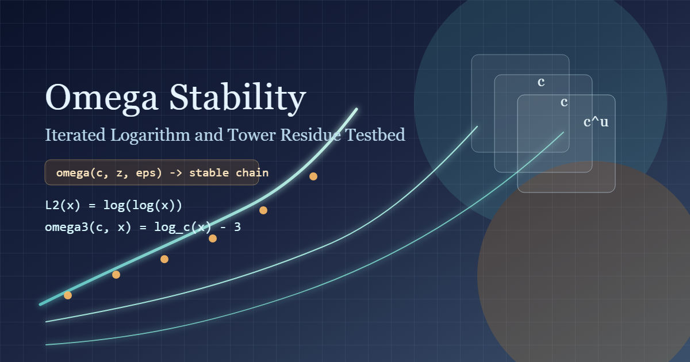

<div align="center">


# EncapsulatorP

**Computational mathematics · experimental number theory · recursive worlds**

Questions worth keeping. Constructions worth exploring. Arguments worth finishing.

**[Open the research atlas →](https://encapsulatorp.github.io/#atlas)**

[](https://encapsulatorp.github.io/#atlas?entry=omega-stability)

</div>

The atlas brings research conversations into a permanent, searchable collection.
Its visual entrance leads to working mathematical exhibits, exact structures,
finite experiments and questions with a concrete next step. Open a thread for
its definitions, argument, source trail and related ideas.

## The living treasure rooms

Goldbach and the Pirate Chest now sit beside Atlas Spark in the navigation.
The other rooms have fresh entrances and working views of the mathematics:

- [Goldbach's observatory](https://encapsulatorp.github.io/#goldbach): choose an even sum, inspect every unordered prime pair, and switch between centre arcs and the exact product curve.
- [The Curious Cabinet](https://encapsulatorp.github.io/#cabinet): two selected views, Catalan's critical disk and C3.2Z's mirror/merge/split dynamics.
- [Hibernating Lemmas](https://encapsulatorp.github.io/#lemmas): factor the neighbours of a square and see the exact twin-prime criterion at work.
- [Collatz](https://encapsulatorp.github.io/#collatz): trace an integer flight before entering the complex Metamorphoses.
- [The Pirate Chest](https://encapsulatorp.github.io/#pirate-chest): move around the Rudin–Shapiro energy circle, then open its written argument.
- [Subject map and repositories](https://encapsulatorp.github.io/#archive): browse mathematics by subject, with a separate shelf explaining the scope of physics explorations.

Atlas Spark's content and its own CSS/JavaScript are preserved. The collection
now has 46 entries; the two Cabinet views deepen existing threads. See the
[edition notes and checks](atlas/living-rooms.md) and
[Cabinet formulas and provenance](atlas/cabinet-notes.md).

## Start with the strongest threads

| Thread | What is available |
|---|---|
| [Omega Stability](https://encapsulatorp.github.io/#atlas?entry=omega-stability) | The connected tower/logarithm/prime-layer thread and the original supplied cover |
| [The order of prime layers](https://encapsulatorp.github.io/#atlas?entry=prime-layer-waves) | An exact local expansion, signed second-harmonic response and recomputed scaling |
| [Alternating tower envelope](https://encapsulatorp.github.io/#atlas?entry=tower-envelope) | Written convergence and sharp-envelope proofs, including two bases for each interior upper remainder |
| [Logistic quarter-turn](https://encapsulatorp.github.io/#atlas?entry=logistic-quarter-turn) | A finite-order linearization at the two-cycle, with its nonlinear scope stated |
| [Catalan’s beta disk](https://encapsulatorp.github.io/#atlas?entry=beta-catalan-disk) | Exact coordinates and operator evaluation, with the zero-location question kept explicit |
| [Abel orbit signature](https://encapsulatorp.github.io/#atlas?entry=abel-orbit-signature) | A proved asymptotic characterization of the standard Collatz orbit outcomes |

**21 November 2026 edition:** 45 entries in five families. Twenty-eight entries
contain exact identities or written arguments; the remainder are finite
observations, reported computations, exploratory constructions, conjectural
directions and research tooling. These are evidence labels, not claims that all
entries are new discoveries. “New to this edition” means new to the atlas.

The selected recovery spans November 2025 to November 2026. It is not a complete
export of every conversation. The [provenance notes](atlas/recovery-notes.md)
record where a source was recovered and where a definition or table remains missing.

## Explore

- [Interactive atlas](https://encapsulatorp.github.io/#atlas): search, family/evidence filters, related threads and three working exhibits.
- [Complete reading copy (PDF)](atlas/README.pdf): every entry, equation and source link. [Markdown source](atlas/README.md).
- [The Pirate Chest · Orbital Treasures](https://encapsulatorp.github.io/#pirate-chest): Brun crossings, dagger towers and research treasures, connected to the atlas.
- [Hibernating Lemmas](https://encapsulatorp.github.io/#lemmas): small exact prime-pair identities and their proofs. The [Goldbach roadmap](lemmas/ROADMAP.md) records the next steps.
- [Goldbach](https://encapsulatorp.github.io/#goldbach), [Collatz](https://encapsulatorp.github.io/#collatz), and [towers](https://encapsulatorp.github.io/#towers): the existing visual exhibits.
- [Validatron](https://encapsulatorp.github.io/#validatron): the mathematical retrieval and proof-development programme.

## Written arguments and reproduction

The [mathematical companion](atlas/mathematical-notes.md) and
[recovered bridges](atlas/recovered-bridges.md) state assumptions and proofs.
Written arguments, finite arithmetic checks and proof-assistant certificates are
distinct. Lean formalization is still pending for the highlighted targets.

```sh
python3 atlas/reproduce.py
python3 atlas/reproduce_experiments.py  # requires mpmath; recorded run used 1.3.0
python3 lemmas/verify_lemmas.py
python3 lemmas/verify_roadmap.py
node atlas/verify_rooms.cjs
```

The first command uses only the standard library. Integer checks are exact;
70-digit decimal/mpmath runs are numerical checks with residuals, not interval
certificates. The finite experiment output is preserved in
[experiment-results.json](atlas/experiment-results.json).

## Maintain the collection

Edit [atlas/catalog.json](atlas/catalog.json), then run:

```sh
python3 atlas/build_catalog.py
```

This validates IDs, evidence labels, source URLs and related-thread links, and
rebuilds the browser data and Markdown reading copy. To refresh the linked PDF,
install Pandoc and the DejaVu fonts, then run:

```sh
python3 -m pip install -r atlas/pdf-requirements.txt
python3 atlas/build_pdf.py
```

The PDF retains all entry text, equations, source URLs and evidence labels, with
clickable contents, related-entry links and PDF bookmarks. Commit the regenerated
`atlas/README.pdf` with content updates. The renderer's docstring includes Ubuntu
setup commands and its `--font-dir` option supports another font installation.

The [Logistic vanishing terms note](atlas/logistic-vanishing-terms.pdf) is maintained in
[its structured source](atlas/logistic-vanishing-terms.json). Rebuild its PDF and
[Markdown reading copy](atlas/logistic-vanishing-terms.md) with:

```sh
python3 -m pip install -r atlas/logistic-pdf-requirements.txt
python3 atlas/build_logistic_vanishing_pdf.py
```

The note also includes an [illustrated proof](atlas/assets/logistic-proof.png) with a
matching [animated PNG](atlas/assets/logistic-proof.apng). To rebuild both pictures
before regenerating the PDF, run `python3 atlas/build_logistic_proof_visual.py`
after installing [the visual dependencies](atlas/logistic-visual-requirements.txt). The PDF contains a still
image linked to the browser animation.

The browser loads local assets without a data-fetch dependency. Existing
analytics and visual exhibits remain part of the showcase.

<a id="buried-chat-stories--four-threads-reopened"></a>

<a id="the-pirate-chest--astral-secrets"></a>

## The Pirate Chest · Orbital Treasures

Recovered threads and checked notes.

- [The Ω series](https://encapsulatorp.github.io/#buried-omega-feedback) follows the Omega fixed point from a feedback loop to two prime layers whose order leaves a measurable second harmonic in the model.
- [The Collatz–Riemann hint that turned around](https://encapsulatorp.github.io/#buried-collatz-riemann-reversal) traces the failed singularity argument back to something exact. The known 1–4–2 cycle produces a pole in its own orbit series, with Abel limit $7/12$ after normalization.
- [The bubble versals tube](https://encapsulatorp.github.io/#buried-bubble-tube) pairs a model of sideways collapse and axial transport with the quarter-turn kernel behind the Catalan integral.
- [Logistic vanishing terms](https://encapsulatorp.github.io/#buried-logistic-vanishing) links the exact logistic two-cycle calculation, recovered notes on exponential maps, Schanuel and Mahler, and a review of the written proofs. [Read the note and proof review (PDF)](atlas/logistic-vanishing-terms.pdf).
- [XO₂, the two-sheet geometron](https://encapsulatorp.github.io/#buried-xo2) lets you flip the square-root sheet at the same input and compare what the zeta-based kernel returns.

*Signed, GPT Sol and Zolton*

## Signed atlas edition

### Paper bodies that open

The [workbench](https://encapsulatorp.github.io/#paper-table) has eight paper bodies
in each of two collections. A globe peels, the hollow portal and Noperthedron
release their faces, an illustrative neck separates, and a Klein-bottle immersion
opens its marked seams. Origami releases its creases; both tensegrity maps remain.
The nine subject links lead to the explanations and then their sources.

The [shape source ledger](atlas/shape-lab-sources.md) credits the supplied Claude
reference and the original mathematical sources. The Paper shapes workflow checks
new geometry and interactions. The [generation roadmap](atlas/shape-generation-roadmap.md)
describes how a future optimizer could propose more bodies for review.

EncapsulatorP is an independent research project led by Zolton. OpenAI’s ChatGPT and Codex assisted with selected calculations, writing, and implementation. Each atlas entry shows its evidence level and sources.

### AI assistance · ChatGPT

**GPT-6 Astra Pro · 21 November 2026**

Recovery, mathematical checks, writing and interactive atlas implementation.

*For the questions worth keeping, and the arguments worth finishing.*

Research direction and original explorations: **Zolton aka Inge / EncapsulatorP**.

### Earlier collaborators and recorded signatures

| Recorded name | Contribution and source |
|---|---|
| **Sol.6.1** | The signature on [Collatz Metamorphoses](https://encapsulatorp.github.io/#collatz), also preserved in exported images. |
| **GPT Sol and Zolton** | The signed note for The Pirate Chest above: Ω feedback, Collatz reversal, bubble tube and XO₂. |
| **GPT and Codex** | Prime Forms constructions, calculations, drawings and integration; Codex also signs The Order of Waves and edits The Pirate Chest. See [Prime Forms authorship](https://github.com/EncapsulatorP/c3._2z/blob/main/index.html#L839-L850). |
| **Claude** | Prime Forms’ white page and blue plates, lattice relief, spectral read-back, Omega drawing and assembly. See [Prime Forms authorship](https://github.com/EncapsulatorP/c3._2z/blob/main/index.html#L839-L850). |
| **Gemini (Neon)** | Living SPEC workspace, neon visual study, RG lattice, model checks and experimental lab sections. See [Prime Forms authorship](https://github.com/EncapsulatorP/c3._2z/blob/main/index.html#L839-L850). |
| **Neo** | Prime Forms visual layout and settings/live-check export helper, as credited in [the project README](https://github.com/EncapsulatorP/c3._2z/blob/main/README.md). |

**[Open the signatures and collaborators →](https://encapsulatorp.github.io/#atlas-credits)**

The recorded names remain as written in their sources. Neo and Gemini (Neon)
are retained as separate source credits; earlier model versions are named only
where a source identifies them. If an earlier version contributes again, its own
dated note and signature can join the page. The signature of this edition does
not replace the earlier signatures or alter their attribution.

Each research entry keeps its evidence level and original source trail.
Classical identities retain their literature context; inclusion does not claim priority.

