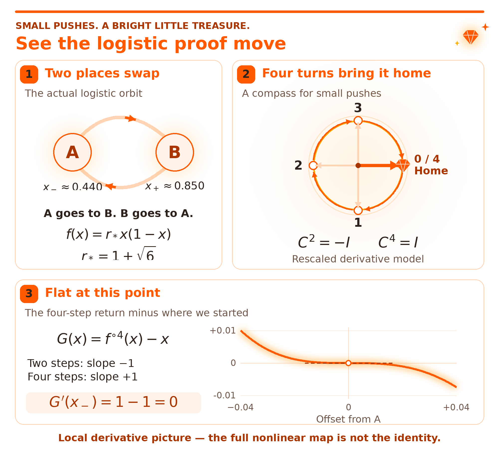

# Logistic vanishing terms

Exact statements, conditional arguments and their proofs

**Zolton / EncapsulatorP · editorial reconstruction and checks with ChatGPT / 23 November 2026**

## Logistic vanishing terms

*ENCAPSULATORP · THE PIRATE CHEST*

A collection of precise results about local logistic dynamics, fractional exponential maps, dyadic limits, finite counts and alternating towers. Each argument states its objects, assumptions and conclusion.

$$
r_* = 1+\sqrt{6},\qquad C_*^2=-I,\qquad C_*^4=I
$$

$$
\left(f_{r_*}^{\circ 4}-\mathrm{id}\right)'(x_\pm)=0
$$

> **The exact centre of this note (exact).** At the logistic two-cycle with r* = 1 + √6, the fourth-return displacement has zero first derivative and the cycle Lyapunov exponent is zero. The paired linear matrix satisfies C² = −I and C⁴ = I. The derivations keep these three statements distinct.

The surrounding threads retain their own definitions and assumptions. The note includes the two constructions of six, real and complex dimensions, the Schanuel-dependent Z(p) family, a Mahler-type series with an exact geometric remainder, ordinary-palindrome counting, alternating towers and prime-polynomial identities.

**Edition 1.2 · 23 November 2026** Research direction and supplied material: **Zolton / EncapsulatorP**. Mathematical reconstruction, calculations and implementation: ChatGPT.

The displayed equations are paired with readable definitions of indices, powers and domains. The companion proof board records the reported transcription issues and links each reviewed argument. The later cubic-attraction derivation is presented separately.

[Open this treasure on the website](https://encapsulatorp.github.io/#buried-logistic-vanishing)

[Open the logistic quarter-turn Atlas entry](https://encapsulatorp.github.io/#atlas?entry=logistic-quarter-turn)

## Three exact views of one cycle

*VISUAL GUIDE · ORBIT, MATRIX AND LOCAL RETURN*

**Read the numbered panels in order.** The scalar orbit exchanges A and B. The rescaled paired matrix makes four quarter-turns. The return-displacement graph has a horizontal tangent at the marked cycle point.

The matrix vector returns exactly after four applications. For the scalar map, the graph shows the local identity: the first derivative of the fourth iterate minus the identity is zero at each cycle point. The next pages derive both statements.

[Watch the picture move · animated PNG (APNG)](https://encapsulatorp.github.io/atlas/assets/logistic-proof.apng)

The PDF displays a still image. Open the linked APNG to step through the exact discrete states of the two-point orbit and the four-state matrix model.

## How to read the collection

*01 · EVIDENCE AND NOTATION*

Read each row as a statement with a domain, a conclusion and a proof. The Z(p) independence argument explicitly assumes complex Schanuel; proposed connections are listed as questions with definitions still to supply.

| Thread | What is established | Status |
| --- | --- | --- |
| Logistic two-cycle | Multiplier −1, a finite-order paired derivative matrix, and local vanishing of a first derivative. | Exact derivation |
| Two constructions of six | Branch derivatives and exact finite-time Lyapunov-average formulas. | Exact; limits need hypotheses |
| Dimension and cardinality | Dimensions 5 and 6 under the specified operations; equal continuum cardinalities. | Exact definitions |
| Z(p) and Schanuel | Rational π-power exponents; algebraic independence if complex Schanuel is assumed. | Exact + conditional |
| Lacunary series | Functional equation and a geometric remainder on a specified dyadic path. | Proved here |
| Palindrome counting | Exact probability for independent uniform symbols. | Proved finite count |
| Alternating towers | Global convergence, sharp height envelope and exactly two bases at interior heights. | Written proof reviewed |
| Prime polynomials | Exact encodings of Goldbach and twin-prime counts. | Written proof reviewed |

### Conventions

All logarithms are natural. The notation f composed m times means iteration, not a scalar power. The fractional part is frac(x) = x − floor(x). Each dimension states its scalar field; finite averages use j = 0 through N−1, exactly N terms.

The real-number identity 6 = 3 + 3 = 3 × 2 is a prompt to compare explicit constructions. A connection becomes a theorem only after the objects, map between them and preserved property are specified.

> **What the mathematical checks establish (exact).** The arguments below establish their stated identities, bounds and classifications. Full proofs appear in the relevant sections and separate notes. The later logistic cubic and asymptotic-ratio results are identified as additions to this collection.

## The logistic two-cycle

*02 · EXACT ALGEBRA*

Let fr(x) = rx(1 − x). For r > 3 the following formulas give a nontrivial real two-cycle. The usual invariant-interval logistic setting additionally restricts r ≤ 4; the distinguished parameter used here lies in that range.

$$
f_r(x)=rx(1-x)
$$

Expanding the second iterate and factoring gives the exact polynomial identity

$$
f_r^{\circ 2}(x)-x=-x(rx-r+1)\,Q_r(x),
$$

$$
Q_r(x)=r^2x^2-r(r+1)x+r+1.
$$

The linear factors describe fixed points. The quadratic supplies the two distinct points

$$
x_\pm=\frac{r+1\pm\sqrt{(r-3)(r+1)}}{2r},
$$

$$
f_r(x_+)=x_-,\qquad f_r(x_-)=x_+.
$$

They merge with a fixed point at r = 3. Differentiate the original map at the two-cycle points and put d± = f′r(x±):

$$
d_\pm=-1\mp\sqrt{(r-3)(r+1)},
$$

$$
\mu(r):=d_+d_-=4+2r-r^2.
$$

The chain rule makes μ(r) the derivative of the second iterate at either point. Solving μ(r) = −1 in the positive logistic range gives

$$
r_*=1+\sqrt{6}\approx3.4494897427831780982.
$$

> **Meaning of the multiplier (exact).** The derivative of one complete two-step return is −1 at r*. After two such returns, the derivative is +1. The next page turns this calculation into the precise vanishing statement.

Source: the pinned recovered-bridges note [S1]. The polynomial factorization and critical multiplier were also checked by exact symbolic expansion.

## What vanishes, and where

*03 · LOCAL RESPONSE AND A QUARTER-TURN*

Define the paired derivative matrix by the chosen order of the two phases:

$$
C_r=\begin{pmatrix}0 & d_- \\ d_+ & 0\end{pmatrix},\qquad C_r^2=\mu(r)I.
$$

At r* = 1 + √6, the discriminant equals 2. Thus

$$
C_*=\begin{pmatrix}0 & \sqrt{2}-1 \\ -1-\sqrt{2} & 0\end{pmatrix},\qquad C_*^2=-I,\quad C_*^4=I.
$$

Writing a = √2 − 1 and S = diag(√a, 1/√a), direct multiplication gives

$$
S^{-1}C_*S=\begin{pmatrix}0 & 1 \\ -1 & 0\end{pmatrix}=:J.
$$

This is a clockwise quarter-turn after a linear change of coordinates. In the original Euclidean metric C* is not orthogonal: its squared column lengths are (1 + √2)² and (√2 − 1)².

$$
\left(f_{r_*}^{\circ 2}\right)'(x_\pm)=-1,\qquad \left(f_{r_*}^{\circ 4}\right)'(x_\pm)=1,
$$

$$
\boxed{\left(f_{r_*}^{\circ 4}-\mathrm{id}\right)'(x_\pm)=0.}
$$

The exponent per application of the original map along this periodic orbit is

$$
\lambda_{\mathrm{cycle}}=\frac12\log|d_+d_-|=\frac12\log 1=0.
$$

> **Three different statements (exact).** The fourth-return displacement has zero first derivative at the cycle points; the cycle Lyapunov exponent is zero; and the defined paired matrix has fourth power I. Each follows from the multiplier calculation.

The nonlinear fourth iterate has degree 16 for r ≠ 0. A zero cycle exponent alone leaves nonlinear stability undecided; the companion cubic note supplies the additional local-attraction argument. At the separate critical point x = 1/2, the **first derivative** is zero and the **map value** is r/4.

These derivative identities are evaluated at the two specified cycle points. Identifying every zero of the derivative of the fourth-return displacement would be a separate root-counting problem.

## Two constructions of six

*04 · FRACTIONAL EXPONENTIAL MAPS*

$$
6=3+3=3\times2,
$$

$$
3^y+3^y=2\,3^y,\qquad 3^y2^y=6^y.
$$

Here 3^y, 2^y and 6^y mean the indicated bases raised to y. Define two maps on y ∈ [0, 1):

$$
T_{\mathrm{add}}(y)=\operatorname{frac}(2\,3^y),\qquad T_{\mathrm{mul}}(y)=\operatorname{frac}(6^y).
$$

The floor term is constant on each smooth branch. Consequently

$$
T_{\mathrm{add}}'(y)=2\,3^y\log3,\qquad T_{\mathrm{mul}}'(y)=6^y\log6,
$$

$$
\log|T_{\mathrm{add}}'(y)|=\log2+y\log3+\log(\log3),
$$

$$
\log|T_{\mathrm{mul}}'(y)|=y\log6+\log(\log6).
$$

### The cuts belong in the definition

Ordinary derivatives fail at the interior fractional-part jumps. Their locations are

$$
y=\frac{\log(m/2)}{\log3},\quad m=3,4,5\qquad(T_{\mathrm{add}}),
$$

$$
y=\frac{\log m}{\log6},\quad m=2,3,4,5\qquad(T_{\mathrm{mul}}).
$$

At y = 0 a right branch derivative is available. A classical orbit Lyapunov exponent requires an orbit on differentiable branches; if an orbit hits a cut or an endpoint, a one-sided branch convention must instead be stated.

> **Uniform branch expansion (exact).** On this domain, |T′add| ≥ 2 log 3 > 1 and |T′mul| ≥ log 6 > 1. Both defined branch Lyapunov averages are strictly positive. They do not reproduce the logistic cycle’s zero exponent.

The scalar equality at the top does not identify the functions or their orbit distributions. It gives two specified constructions whose dynamics can be compared.

## Comparing the Lyapunov averages

*05 · EXACT FINITE-TIME IDENTITIES*

Take a separate orbit for each map, with the branch convention just stated. For a ∈ {add, mul} and integer N ≥ 1, use exactly N samples: j = 0, 1, …, N−1. Define

$$
\mu_{a,N}=\frac1N\sum_{j=0}^{N-1}y_j^a,\qquad \lambda_{a,N}=\frac1N\sum_{j=0}^{N-1}\log|T_a'(y_j^a)|.
$$

Averaging the branch identities gives

$$
\lambda_{\mathrm{add},N}=\log2+\mu_{\mathrm{add},N}\log3+\log(\log3),
$$

$$
\lambda_{\mathrm{mul},N}=\mu_{\mathrm{mul},N}\log6+\log(\log6).
$$

Subtracting, with ΔλN = λmul,N − λadd,N, yields the submitted formula in finite-time form:

$$
\Delta\lambda_N=\mu_{\mathrm{mul},N}\log6-\mu_{\mathrm{add},N}\log3+\log\!\left(\frac{\log6}{\log3}\right)-\log2.
$$

If both orbit means converge, the same equation holds for their limits μadd, μmul and Δλ. The means are attached to different dynamics. Neither a common invariant measure nor the substitution μ = 1/2 has been established here.

### An exact boundary for the proposed bridge

$$
\lambda_{\mathrm{add},N}\ge\log(2\log3)\approx0.7871950082,
$$

$$
\lambda_{\mathrm{mul},N}\ge\log(\log6)\approx0.5831980808.
$$

A zero difference would require the two mean contributions to satisfy

$$
\mu_{\mathrm{mul}}\log6-\mu_{\mathrm{add}}\log3=\log\!\left(\frac{2\log3}{\log6}\right).
$$

> **Open question, with a testable target (open).** Determine the relevant invariant measures or orbit-mean limits before evaluating the limiting difference. These calculations compare derivative products; they establish no conjugacy, shared invariant measure or shared bifurcation structure with the logistic family.

Numerical decimals on this page are illustrations of the exact logarithmic bounds, not interval-certified values.

## Dimensions, cardinality and fragments

*06 · RECOVERED DEFINITIONS*

The dimension fragment becomes unambiguous after specifying both the operation and the scalar field.

| Construction | Dimension | Reason |
| --- | --- | --- |
| ℝ³ × ℝ² | 5 over ℝ | A point has three plus two real coordinates. |
| ℝ³ ⊗ℝ ℝ² | 6 over ℝ | The six elementary tensors eᵢ ⊗ fⱼ form a basis. |
| ℂ³ viewed over ℝ | 6 over ℝ | Each complex coordinate gives two real coordinates. |
| ℂ³ viewed over ℂ | 3 over ℂ | Three standard complex basis vectors. |

$$
|\mathbb{R}^5|=|\mathbb{R}^6|=|\mathbb{C}^3|=|\mathbb{R}|=2^{\aleph_0}.
$$

For cardinality, identify the reals with subsets of a countable set. A finite tuple of such subsets is encoded by a subset of finitely many disjoint copies of that set; their union is still countable. Equality of these set sizes does not identify vector-space dimension. Fractal dimension and physical degrees of freedom require their own definitions and structures.

### The cubic and Collatz fragments

$$
z^3-1=(z-1)(z^2+z+1),
$$

$$
3n+1,\qquad \frac{3n+1}{2}.
$$

The first is a standard polynomial factorization. For an odd positive integer n, the other two expressions represent different Collatz conventions: the unaccelerated odd step, and that step followed by one division by two. The full odd-to-odd Syracuse step removes every factor of two.

No map linking these cubic roots, the Collatz branches and the logistic quarter-turn was supplied. Their appearance in the same notebook is retained as a proposed research connection, not an equivalence.

> **Unassigned archival labels (open).** T₀, T₁, T₂ and T₃ were supplied without definitions. They remain placeholders. No transition rule, four-layer tower construction or identity among them is inferred.

A useful next recovery is the definition of each T-label and the intended map from the cubic or Collatz expressions to the other constructions. That would turn a remembered association into a question we can check.

## The Z(p) family

*07 · EXACT REDUCTION; CONDITIONAL INDEPENDENCE*

Let p be an odd integer at least 3. Primality is optional. Define

$$
Z(p)=\exp\!\left(\frac{\pi\zeta(p-1)}p\right)+1.
$$

For p = 2m + 1 with m ≥ 1, Euler’s even-zeta evaluation [S3] gives

$$
\zeta(2m)=\frac{(2\pi)^{2m}}{2(2m)!}|B_{2m}|,
$$

$$
Z(p)=e^{c_p\pi^p}+1,\qquad c_p=\frac{2^{p-2}|B_{p-1}|}{p!}\in\mathbb{Q}_{>0}.
$$

Here B2m denotes a Bernoulli number. Equivalently

$$
c_{2m+1}=\frac{(-1)^{m+1}2^{2m-1}B_{2m}}{(2m+1)!}.
$$

| p | cₚ | Exponent in Z(p) − 1 |
| --- | --- | --- |
| 3 | 1/18 | π³/18 |
| 5 | 1/450 | π⁵/450 |
| 7 | 1/6615 | π⁷/6615 |

The case p = 2 is excluded because ζ(1) has a pole. For even p ≥ 4, the displayed rational coefficient does not follow from the even-zeta formula.

> **Conditional proposition (conditional).** Assume the full complex Schanuel conjecture. For pairwise distinct odd integers p₁, …, pₖ ≥ 3, the numbers π, Z(p₁), …, Z(pₖ) are algebraically independent over ℚ.

“Algebraically independent” means that no nonzero polynomial with rational coefficients in these k + 1 variables vanishes on the tuple. The next page gives the deduction and keeps the assumption visible.

The rational-coefficient reduction is unconditional. Algebraic independence of π and the selected Z(p) values, including the resulting individual-transcendence conclusions, follows under the stated complex Schanuel assumption.

## The conditional Schanuel argument

*08 · COMPLETE DEDUCTION AND DOMAIN LIMITS*

Complex Schanuel states that for ℚ-linearly independent complex numbers α₀, …, αₖ, the field generated by these numbers and their exponentials has transcendence degree at least k + 1 over ℚ [S4]. Apply it to

$$
\alpha_0=i\pi,\qquad \alpha_j=c_{p_j}\pi^{p_j}\quad(1\le j\le k).
$$

**Linear independence.** The imaginary part of a rational relation forces the coefficient of iπ (i times pi) to vanish. The remaining relation is a polynomial in π (pi), with distinct powers and nonzero rational coefficients c_p. Transcendence of π forces every remaining coefficient to vanish.

**The Schanuel bound.** With E the field generated by these inputs and their exponentials, the conjecture gives

$$
E=\mathbb{Q}(\alpha_0,\ldots,\alpha_k,e^{\alpha_0},\ldots,e^{\alpha_k}),\qquad \operatorname{trdeg}_{\mathbb{Q}}E\ge k+1.
$$

Euler’s identity gives exp(α₀) = −1, while exp(αⱼ) = Z(pⱼ) − 1. Therefore

$$
E\subseteq K:=\mathbb{Q}(i,\pi,Z(p_1),\ldots,Z(p_k)).
$$

Adjoining i is algebraic, so

$$
\operatorname{trdeg}_{\mathbb{Q}}K=\operatorname{trdeg}_{\mathbb{Q}}\mathbb{Q}(\pi,Z(p_1),\ldots,Z(p_k))\le k+1.
$$

The lower and upper bounds force equality. A field generated by k + 1 numbers has transcendence degree k + 1 exactly when those generators are algebraically independent. This proves the conditional proposition. The field containment above suffices; literal equality of E and K is not needed.

> **Why the complex version matters (conditional).** The selected inputs include iπ. A real-only version of Schanuel is not the assumption used in this proof.

### The Euler counterexample has a domain

$$
q=i,\quad m=1:\qquad e^{q\pi^m}=e^{i\pi}=-1.
$$

This refutes a blanket transcendence claim allowing every nonzero **complex algebraic** coefficient q. It does not refute a claim restricted to rational or real q, since i is neither. Lindemann’s algebraic-input theorem does not directly apply to cpπp, whose input is transcendental.

The deduction uses the stated conjecture, the even-zeta formula and the transcendence of π. Field containment provides the required bound.

## A dyadic path with a vanishing remainder

*09 · LACUNARY SERIES; ELEMENTARY PROOF*

Define the lacunary series using the exponent 2^n, meaning 2 raised to n:

$$
f(x)=\sum_{n=0}^{\infty}x^{2^n},\qquad |x|<1,\qquad f(x)=x+f(x^2).
$$

For every integer n ≥ 0, 2^n ≥ n + 1. When |x| < 1, comparison with the geometric series Σ |x|^(n+1) proves absolute convergence. An index shift then proves the functional equation.

$$
x_k=e^{-2^{-k}},\quad k=0,1,2,\ldots,\qquad x_k^2=x_{k-1}\quad(k\ge1).
$$

Repeated substitution in the functional equation gives

$$
f(x_k)=f(e^{-1})+\sum_{j=1}^{k}e^{-2^{-j}}.
$$

Define the finite constant

$$
C=f(e^{-1})+\sum_{j=1}^{\infty}(e^{-2^{-j}}-1).
$$

The second series converges absolutely because 0 ≤ 1 − exp(−t) ≤ t for t ≥ 0. Subtraction gives the exact tail

$$
R_k:=f(x_k)-k-C=\sum_{j=k+1}^{\infty}(1-e^{-2^{-j}}).
$$

$$
0\le R_k\le\sum_{j=k+1}^{\infty}2^{-j}=2^{-k}.
$$

The inequality t − t²/2 ≤ 1 − exp(−t) gives the sharper lower bound:

$$
2^{-k}-\frac{4^{-k}}6\le R_k\le2^{-k}.
$$

Numerically, f(exp(−1)) ≈ 0.52186593845987908905 and C ≈ −0.33274738243289922501. These decimals illustrate the exact identities; the inequalities above supply the proof.

> **Scope of the limit (exact).** Along x_k = exp(−2^(−k)), the remainder bound gives f(x_k) = k + C + O(2^(−k)). The constant C belongs to this specified path. The arithmetic classification of f(exp(−1)) remains a separate question.

The input exp(−1) is transcendental. A Mahler-value theorem requiring algebraic input therefore needs different hypotheses before it can apply here.

## Forty positions, four symbols

*10 · EXACT COUNTING AND THE BIOPHYSICS BOUNDARY*

Choose symbols independently and uniformly from an alphabet of integer size q ≥ 2. For integer length n ≥ 1, an ordinary palindrome reads identically under reversal. There are ceiling(n/2) free positions, giving q^ceiling(n/2) palindromes among q^n strings.

$$
\mathbb{P}(\mathrm{ordinary\ palindrome})=\frac{q^{\lceil n/2\rceil}}{q^n}=q^{-\lfloor n/2\rfloor}.
$$

For even n, floor(n/2) = n/2, so the probability simplifies to q^(−n/2). With q = 4 and n = 40,

$$
\mathbb{P}=4^{-20}=2^{-40}=\frac1{1\,099\,511\,627\,776}
$$

$$
\mathbb{P}\approx9.094947017729282\times10^{-13}.
$$

The reciprocal gives an expected 1.10 × 10^12 independent **complete-string draws** per first success, including the successful draw. Overlapping windows require a separate dependence model.

| Alphabet size q | Length n | Ordinary-palindrome probability |
| --- | --- | --- |
| 4 | 40 | 4^(−20) = 2^(−40) |
| 6 | 40 | 6^(−20) |
| 8 | 40 | 8^(−20) = 2^(−60) |
| 12 | 40 | 12^(−20) |
| 40 | 40 | 40^(−20) |

> **What the number 40 means (open).** In the displayed example, 40 is the sequence length n and the alphabet size is q = 4. Taking q = 40 defines a different abstract counting experiment. Neither calculation establishes a maximum sustainable DNA alphabet, a chemical stability threshold or an optimal decay rate.

### Reversal and reverse complementation

For reverse-complement palindromes, assume a fixed-point-free complement pairing and the same sampling model. Then q is even. Even lengths have probability q^(−n/2); odd lengths are impossible because the central symbol would have to complement itself.

The suggested synthetic-alphabet and biophysics thread therefore remains a research direction. It needs an explicit physical model, measurable stability criteria and suitable evidence beyond this combinatorial count.

## Alternating real towers converge

*11 · WRITTEN-PROOF REVIEW: GLOBAL RESULT*

Fix a real c > 1 and L = log c. The following alternating-sign system has exactly one solution with 0 < u < 1 < v [S2]:

$$
u=c^{-v},\qquad v=c^u.
$$

Eliminate u and define

$$
F_L(v)=\exp(Le^{-Lv}),\qquad v_{j+1}=F_L(v_j).
$$

**Invariant interval.** For v ≥ 1,

$$
1<F_L(v)\le\exp(Le^{-L})\le e^{1/e}.
$$

The function L exp(−L) has maximum 1/e at L = 1. Every v₀ ≥ 1 therefore enters I = [1, exp(1/e)] after one step.

**Uniform contraction.** Differentiate and use the separate maxima of L² exp(−L) and L exp(−L):

$$
|F_L'(v)|=L^2e^{-Lv}\exp(Le^{-Lv})
$$

$$
\le L^2e^{-L}\exp(Le^{-L})\le q:=4e^{1/e-2}<1.
$$

This convenient bound is uniform in L and v. To prove q < 1 without decimals, use 1/e < 1/2 and exp(3/2) > 1 + 3/2 + 9/8 + 27/48 > 4. Numerically q ≈ 0.782058136610352468.

**Existence, uniqueness and convergence.** Apply Banach’s contraction theorem on I. Every possible fixed point in the stated domain lies in I, so it is unique throughout that domain. Set u = exp(−Lv) to recover both phase equations. Every v₀ ≥ 1 converges.

$$
|x-v_*|\le\frac{|F_L(x)-x|}{1-q}\qquad(x\in I).
$$

The error bound follows by inserting FL(x), using the contraction inequality and rearranging. Rounded function values alone do not turn it into an interval certificate.

> **Conclusion (exact).** For every c > 1, the defined alternating-sign system has a unique solution with 0 < u < 1 < v. Its stated iteration converges from every v₀ ≥ 1 with a uniform contraction bound.

## A sharp height and exactly two bases

*12 · WRITTEN-PROOF REVIEW: EXACT CLASSIFICATION*

At the fixed point of the alternating system, put t = Lv > 0. Taking logarithms of the fixed-point equation and multiplying by v yields

$$
v\log v=t e^{-t}\le1/e.
$$

Because v log v is strictly increasing on v ≥ 1, this bounds the upper phase sharply. With W₀ the principal real Lambert W function,

$$
v_{\max}=\exp(W_0(1/e))\approx1.321099762015617456962.
$$

Equality is attained by t = 1 and L = 1/vmax. The base attaining the maximum height is

$$
c_{\mathrm{peak}}=\exp(1/v_{\max})\approx2.131753981723805825514.
$$

The earlier review called this cmax. The label cpeak avoids suggesting that there is a largest allowable base: the theorem permits every c > 1.

### Why there are exactly two bases

For 1 < v < v_max, set a = v log v ∈ (0, 1/e). The function t exp(−t) increases to t = 1 and then decreases to zero. Thus

$$
t e^{-t}=a
$$

has exactly two positive solutions t− < 1 < t+. Each gives a distinct base

$$
c_-=e^{t_-/v},\qquad c_+=e^{t_+/v}.
$$

| Upper phase | Number of finite real bases c > 1 |
| --- | --- |
| 1 < v < vₘₐₓ | Exactly two |
| v = vₘₐₓ | Exactly one |
| v > vₘₐₓ | None |
| v = 1 | None; only a limiting height |

> **Conclusion (exact).** The sharp upper-phase bound is attained. Each interior height corresponds to exactly two finite bases, the maximum to one, and all other listed heights to none.

The convergence theorem and the inverse classification form one complete argument: first construct the unique phase pair for each base, then determine exactly which bases realize a chosen height.

## Prime polynomials count exactly

*13 · WRITTEN-PROOF REVIEW: FINITE IDENTITIES*

For integer X ≥ 2, form the finite prime polynomial

$$
P_X(z)=\sum_{p\le X,\ p\ \mathrm{prime}}z^p.
$$

All coefficient extractions here are formal and finite. No analytic convergence assumption is required.

### Goldbach reflection

For integer N ≥ 4, multiplication gives

$$
G(N)=[z^N]P_N(z)^2
$$

$$
=\#\{(p,q):p,q\ \mathrm{prime},\ p+q=N\}.
$$

This counts ordered pairs. Put D(N) = 1 if N/2 is an integer prime, and 0 otherwise. If U(N) counts unordered pairs, then

$$
G(N)=2U(N)-D(N),\qquad U(N)=\frac{G(N)+D(N)}2.
$$

Every unequal pair is counted twice in G; the diagonal is counted once. This proves the correction exactly.

### Twin-prime translation

In the finite Laurent-polynomial ring,

$$
T(X)=[z^2]P_{X+2}(z)P_X(z^{-1})
$$

$$
=\#\{p\le X:p,\ p+2\ \mathrm{prime}\}.
$$

A term has exponent q − p. Selecting the coefficient of z² imposes q = p + 2, which proves the identity.

> **Conclusion (exact).** The finite polynomial products give exact ordered, unordered and translated prime-pair counts. Their proofs are coefficient extraction and the explicit diagonal correction.

One product encodes the reflection p + q = N; the Laurent product encodes the translation q − p = 2. A lower bound or asymptotic estimate for these coefficients would require an additional argument.

## What the written arguments establish

*MATHEMATICAL REVIEW · STATEMENTS AND PROOF STEPS*

The original review inspected the site at commit **29f9232545aa112cd6ffa9fe1f3c0e85d093dedd**. Its four subjects are listed below. The companion proof board also covers the remaining collection and separates the later cubic and asymptotic additions.

| Argument | Conclusion and proof step |
| --- | --- |
| Logistic two-cycle | Factor the second iterate; calculate the multiplier and the defined paired matrix; evaluate the fourth-return displacement derivative at the cycle points. |
| Alternating towers | Map into a closed invariant interval and apply a uniform contraction bound to obtain existence, uniqueness and convergence. |
| Sharp height and two bases | Use v log v = t exp(−t), its maximum and its two inverse branches to classify every admissible upper height. |
| Prime-polynomial counts | Extract finite coefficients and correct the diagonal to count ordered, unordered and translated prime pairs. |

The written algebra and inequalities supply the proofs. Numerical values and symbolic simplification support the checks; the statements retain their specified domains and hypotheses.

### Continue with a precise question

For the fractional maps, identify the orbit means or invariant measures to study. For T₀–T₃, recover the definitions. For the geometric interpretation, specify the object, evolution and quantity whose disappearance is proposed.

[Proof board · statements, corrections and direct proof links](https://encapsulatorp.github.io/atlas/proof-review-board.html)

> **Review finding (exact).** The reviewed arguments establish the identities, bounds and classifications stated here. The later cubic-attraction proof and the explicitly defined geometric model remain clearly identified as subsequent additions.

## Sources, provenance and continuation

*15 · TRACEABLE READING COPY*

### Pinned programme sources

**[S1] Logistic quarter-turn.** EncapsulatorP, *Recovered constructions*, §2, “Logistic two-cycle: a finite-order linearization”. Pinned source for the factorization, paired matrix and fourth-iterate derivative statement.

[Read the logistic source at the reviewed commit](https://github.com/EncapsulatorP/EncapsulatorP.github.io/blob/29f9232545aa112cd6ffa9fe1f3c0e85d093dedd/atlas/recovered-bridges.md#logistic-quarter-turn)

**[S2] Written tower and prime-polynomial proofs.** EncapsulatorP, *Exact structures behind the atlas*, edition 21 November 2026, §§1, 2 and 4. The source supplies the complete arguments, their domains and the numerical-reproduction details.

[Read the mathematical notes at the reviewed commit](https://github.com/EncapsulatorP/EncapsulatorP.github.io/blob/29f9232545aa112cd6ffa9fe1f3c0e85d093dedd/atlas/mathematical-notes.md)

### External mathematical references

**[S3] Euler’s even-zeta evaluation.** NIST Digital Library of Mathematical Functions, §25.6, equation 25.6.2. This is the classical input to the exact rational coefficient cp.

[NIST DLMF · equation 25.6.2](https://dlmf.nist.gov/25.6.E2)

**[S4] Complex Schanuel conjecture.** Isaac A. Broudy and Sebastian Eterović, *Schanuel type conjectures and disjointness*, The Ramanujan Journal 62 (2023), 781–795, Conjecture 3.1. The article supplies the statement of the conjecture; the specific Z(p) deduction is written out in this note.

[Research article · DOI 10.1007/s11139-023-00707-3](https://link.springer.com/article/10.1007/s11139-023-00707-3)

### Editorial record

The submitted fragments and written review are reproduced with explicit indices, powers and domains. This edition makes those notational distinctions readable in prose as well as equations, uses c_peak for the height-maximizing tower base, and distinguishes sequence length n = 40 from alphabet size q = 40. T₀–T₃ remain unassigned labels.

The fractional-map formulas, dyadic bound, cardinality argument and palindrome count are derived in this document. References [S3] and [S4] supply the classical even-zeta identity and the stated complex Schanuel assumption. Each focused note links its complete proof.

[Treasure Chest · this note](https://encapsulatorp.github.io/#buried-logistic-vanishing)

[Editable reading source · Markdown](https://github.com/EncapsulatorP/EncapsulatorP.github.io/blob/main/atlas/logistic-vanishing-terms.md)

[Structured source and reproducible PDF renderer](https://github.com/EncapsulatorP/EncapsulatorP.github.io/blob/main/atlas/build_logistic_vanishing_pdf.py)

Build from the repository root with: **python3 atlas/build_logistic_vanishing_pdf.py**. Dependencies and font setup are documented beside the renderer. The structured source is atlas/logistic-vanishing-terms.json.
