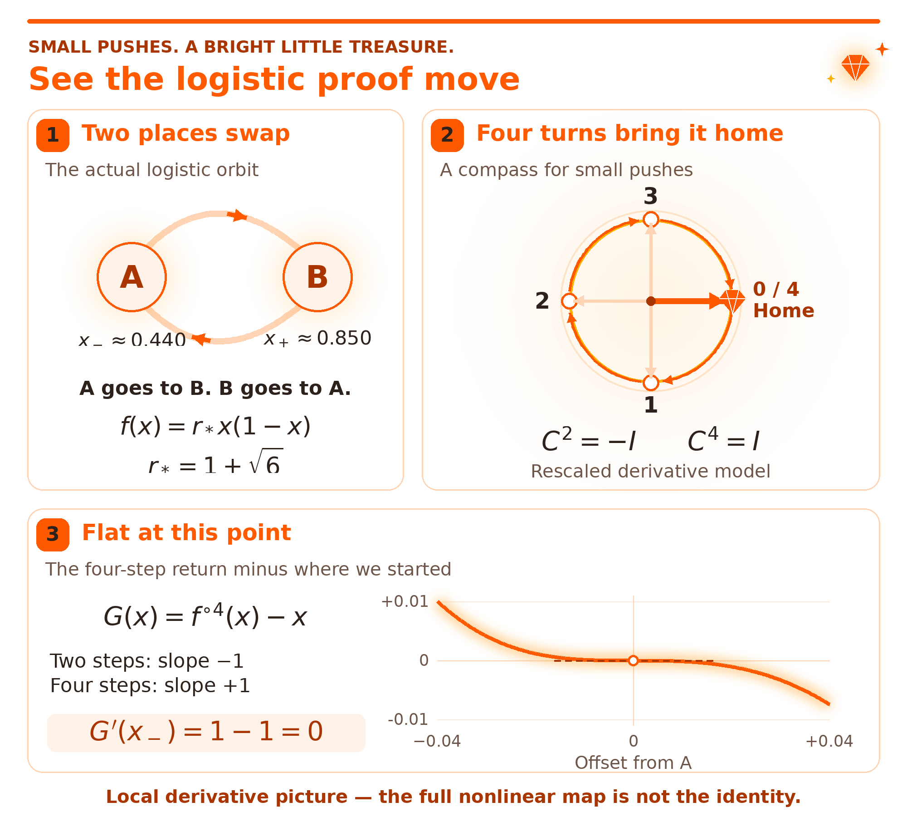

# Valid proofs & surviving arguments

**EncapsulatorP / 2026-11-23**

Source commit: `f165f366bfd416c92042f56139ece377bb4b42d8`

## Valid proofs & surviving arguments

*A / B / C · Review and navigation*

| A · Audit | B · Statements | C · Final board | S · Later work |
| --- | --- | --- | --- |
| Notation and editions **Pages 2–3** | 14 claims + hypotheses **Pages 4–7** | Valid arguments + limits **Page 8** | Cubic, rate and model **Pages 9–10** |

**Edition record.** The audit compares the 16-page electric-orange and 17-page illustrated PDFs. The exact earlier review excerpt is unknown. Later results are separated on pages 9–10. Click the figure for the complete logistic proof.

## A. Notation and edition audit

*01–04 · Read the symbol in context*

**Audit scope.** Compared the complete 16-page electric-orange PDF, the 17-page illustrated PDF, their canonical Markdown and JSON, visible page renders and extracted text. The reported page numbers match the 16-page edition. The exact file or excerpt supplied to the earlier reviewer is unknown.

### A1. Critical point and derivative

**Source and print correct.** Earlier edition p. 4; illustrated edition p. 5.

$$
f_r(1/2)=r/4,\qquad f'_r(1/2)=0.
$$

The full PDF already prints the derivative prime. The reported statement without it is not reproduced.

[Check the formula in its focused note](https://encapsulatorp.github.io/atlas/proofs/logistic-quarter-turn.html)

### A2. Exactly N terms

**Source and print correct.** Earlier edition p. 6; illustrated edition p. 7.

$$
\lambda_{a,N}=\frac1N\sum_{j=0}^{N-1}\log|T'_a(y_j^a)|.
$$

Both upper limits already read N−1. Extraction fragments the equation, so the revision preserves a complete readable formula.

[Check the formula in its focused note](https://encapsulatorp.github.io/atlas/proofs/fractional-exponential-maps.html)

### A3. Ceiling and floor

**Source and print correct.** Earlier edition p. 11; illustrated edition p. 12.

$$
\mathbb{P}(\mathrm{palindrome})=\frac{q^{\lceil n/2\rceil}}{q^n}=q^{-\lfloor n/2\rfloor}.
$$

The numerator already uses ceiling and the final exponent uses floor. The formula covers odd and even lengths.

[Check the formula in its focused note](https://encapsulatorp.github.io/atlas/proofs/palindrome-counting.html)

### A4. The nested exponent

**Extraction loss confirmed.** Earlier edition p. 10; illustrated edition p. 11.

$$
f(x)=\sum_{n=0}^{\infty}x^{2^n},\qquad |x|<1.
$$

The printed exponent is 2^n. Copying the PDF can flatten it to 2n; this loss of mathematical structure was reproduced.

[Check the formula in its focused note](https://encapsulatorp.github.io/atlas/proofs/dyadic-remainder.html)

## A. Notation and source coverage

*05–09 · Symbols, coefficients and the missing-section report*

### A5. π in the proposition

**Source and print correct.** Earlier edition p. 8; illustrated edition p. 9.

$$
\pi,Z(p_1),\ldots,Z(p_k).
$$

Both the source and inspected PDF say π. The reported n substitution is absent from the inspected versions.

[Check the formula in its focused note](https://encapsulatorp.github.io/atlas/proofs/schanuel-zeta-family.html)

### A6. The input iπ

**Source and print correct.** Earlier edition p. 9; illustrated edition p. 10.

$$
\alpha_0=i\pi.
$$

The coefficient sentence and assumption box already say iπ. These complex inputs belong to the conditional argument.

[Check the formula in its focused note](https://encapsulatorp.github.io/atlas/proofs/schanuel-zeta-family.html)

### A7. One coefficient c

**Source and print correct.** Earlier edition p. 8; illustrated edition p. 9.

$$
c_{2m+1}=\frac{(-1)^{m+1}2^{2m-1}B_{2m}}{(2m+1)!}.
$$

The printed letter is lowercase c. The signed Bernoulli expression equals the same positive rational coefficient.

[Check the formula in its focused note](https://encapsulatorp.github.io/atlas/proofs/schanuel-zeta-family.html)

### A8. The continuum exponent

**Source and print correct.** Earlier edition p. 7; illustrated edition p. 8.

$$
|\mathbb{R}^5|=|\mathbb{R}^6|=|\mathbb{C}^3|=|\mathbb{R}|=2^{\aleph_0}.
$$

The source and rendered exponent use aleph-zero. The reported N-zero substitution is not reproduced.

[Check the formula in its focused note](https://encapsulatorp.github.io/atlas/proofs/dimensions-and-fragments.html)

### A9. The prime-polynomial section

**Present in full PDFs.** Earlier edition p. 14; illustrated edition p. 15.

$$
G(N)=[z^N]P_N(z)^2,\qquad U(N)=\frac{G(N)+D(N)}2.
$$

The full section is present on page 14 of the 16-page edition and page 15 of the illustrated edition. The exact excerpt received by the earlier reviewer is unknown.

[Check the formula in its focused note](https://encapsulatorp.github.io/atlas/proofs/prime-polynomial-counts.html)

## B. Logistic identities

*01–04 · Exact local statements*

### B1. Logistic two-cycle

**EXACT · Hypotheses.** Real r > 3; also r ≤ 4 for the conventional invariant interval [0,1].

$$
f_r^{\circ2}(x)-x=-x(rx-r+1)[r^2x^2-r(r+1)x+r+1].
$$

$$
x_\pm=\frac{r+1\pm\sqrt{(r-3)(r+1)}}{2r}.
$$

$$
d_\pm=-1\mp\sqrt{(r-3)(r+1)},\qquad d_+d_-=4+2r-r^2.
$$

Polynomial algebra also proves that fᵣ exchanges these two distinct nontrivial points.

[Read the complete proof note](https://encapsulatorp.github.io/atlas/proofs/logistic-quarter-turn.html)

### B2. Paired quarter-turn matrix

**EXACT · Hypotheses.** At r* = 1 + √6, define C = [[0,d₋],[d₊,0]], a = √2 − 1 and S = diag(√a,1/√a).

$$
C_*^2=-I,\qquad C_*^4=I,\qquad \det C_*=1.
$$

$$
S^{-1}C_*S=\begin{pmatrix}0 & 1 \\ -1 & 0\end{pmatrix}.
$$

This explicitly defined linear matrix has rank 2. The conjugacy is a coordinate rescaling; C is not Euclidean orthogonal in the original coordinates.

[Read the complete proof note](https://encapsulatorp.github.io/atlas/proofs/logistic-quarter-turn.html)

### B3. Vanishing derivative of the return displacement

**EXACT · Hypotheses.** At either cycle point p± for r* = 1 + √6.

$$
(f^{\circ2})'(p_\pm)=-1,\quad(f^{\circ4})'(p_\pm)=1,\quad(f^{\circ4}-\mathrm{id})'(p_\pm)=0.
$$

These identities concern the stated cycle points. At the separate critical point 1/2, fᵣ′(1/2) = 0 while fᵣ(1/2) = r/4.

[Read the complete proof note](https://encapsulatorp.github.io/atlas/proofs/logistic-quarter-turn.html)

### B4. Zero cycle Lyapunov exponent

**EXACT · Hypotheses.** The exact r* two-cycle; exponent per original logistic update.

$$
\lambda_{\mathrm{cycle}}=\frac12\log|d_+d_-|=0.
$$

A zero exponent leaves nonlinear stability undecided. The later cubic attraction argument is presented separately on page 9.

[Read the complete proof note](https://encapsulatorp.github.io/atlas/proofs/logistic-quarter-turn.html)

## B. Maps, dimensions and coefficients

*05–08 · Domains and operations made explicit*

### B5. Two constructions of six

**EXACT · Hypotheses.** Tadd(y) = frac(2·3ʸ), Tmul(y) = frac(6ʸ), y ∈ [0,1), N ≥ 1; use the stated branch derivatives.

$$
\lambda_{a,N}=\frac1N\sum_{j=0}^{N-1}\log|T'_a(y_j^a)|,\quad\Delta\lambda_N=\mu_{\mathrm{mul},N}\log6-\mu_{\mathrm{add},N}\log3+\log\frac{\log6}{\log3}-\log2.
$$

The means μadd,N and μmul,N belong to separate orbit segments. Ordinary derivatives fail at jumps; the note specifies endpoint conventions. Infinite-time formulas require convergent means.

[Read the complete proof note](https://encapsulatorp.github.io/atlas/proofs/fractional-exponential-maps.html)

### B6. Dimension and cardinality

**EXACT · Hypotheses.** Use the indicated real or complex scalar field; cardinality concerns the underlying set.

$$
\dim_{\mathbb{R}}(\mathbb{R}^3\times\mathbb{R}^2)=5,\quad\dim_{\mathbb{R}}(\mathbb{R}^3\otimes_{\mathbb{R}}\mathbb{R}^2)=6.\qquad\dim_{\mathbb{R}}\mathbb{C}^3=6,\quad\dim_{\mathbb{C}}\mathbb{C}^3=3,\quad|\mathbb{R}^5|=|\mathbb{R}^6|=|\mathbb{C}^3|=2^{\aleph_0}.
$$

Products, tensor products, changes of scalar field and cardinality answer different mathematical questions.

[Read the complete proof note](https://encapsulatorp.github.io/atlas/proofs/dimensions-and-fragments.html)

### B7. Cubic factorization and odd-step conventions

**EXACT · Hypotheses.** Complex z; odd positive integer n for the iteration conventions.

$$
z^3-1=(z-1)(z^2+z+1).
$$

3n + 1 and (3n + 1)/2 are distinct odd-step conventions. The latter divides once; the full odd-to-odd step removes all factors of two. T₀–T₃ still need definitions and a connecting map.

[Read the complete proof note](https://encapsulatorp.github.io/atlas/proofs/dimensions-and-fragments.html)

### B8. Exact reduction of Z(p)

**EXACT · Hypotheses.** Odd integers p ≥ 3; primality is not required.

$$
Z(p)=1+\exp\!\left(\frac{\pi\zeta(p-1)}p\right)=1+e^{c_p\pi^p}.\quad c_p=\frac{2^{p-2}|B_{p-1}|}{p!}\in\mathbb{Q}_{>0}.
$$

Euler’s even-zeta evaluation supplies the coefficient. The signed Bernoulli expression in A7 gives the same lowercase c. At p = 2, ζ(1) has a pole.

[Read the complete proof note](https://encapsulatorp.github.io/atlas/proofs/schanuel-zeta-family.html)

## B. Arithmetic, limits and counting

*09–11 · One conditional argument; two exact counts and bounds*

### B9. Conditional algebraic independence

**CONDITIONAL · Hypotheses.** Assume full complex Schanuel; p₁,…,pₖ are pairwise distinct odd integers ≥ 3.

Then π, Z(p₁), …, Z(pₖ) are algebraically independent over Q. Apply the assumption to iπ and the real inputs cₚⱼπᵖⱼ.

$$
E\subseteq\mathbb{Q}(i,\pi,Z(p_1),\ldots,Z(p_k)),\quad k+1\le\operatorname{trdeg}_{\mathbb{Q}}E\le k+1.
$$

E is generated over Q by these inputs and their exponentials. The imaginary part isolates iπ in a rational linear relation. Transcendence of π handles the distinct real powers; adjoining i is algebraic.

[Read the complete proof note](https://encapsulatorp.github.io/atlas/proofs/schanuel-zeta-family.html)

### B10. Dyadic series and vanishing remainder

**EXACT · Hypotheses.** f(x) = Σₙ≥₀ x^(2^n), |x| < 1; xₖ = exp(−2^(−k)), integer k ≥ 0.

The functional equation f(x) = x + f(x²) gives f(xₖ) = k + C + Rₖ.

$$
f(x)=\sum_{n=0}^{\infty}x^{2^n},\qquad f(x)=x+f(x^2),\qquad x_k=e^{-2^{-k}}.
$$

$$
C=f(e^{-1})+\sum_{j=1}^{\infty}(e^{-2^{-j}}-1),\quad R_k=\sum_{j=k+1}^{\infty}(1-e^{-2^{-j}}),\quad2^{-k}-\frac{4^{-k}}6\le R_k\le2^{-k}.
$$

Absolute convergence, an index shift and t − t²/2 ≤ 1 − exp(−t) ≤ t prove the stated bound. C belongs to the specified dyadic path.

[Read the complete proof note](https://encapsulatorp.github.io/atlas/proofs/dyadic-remainder.html)

### B11. Ordinary palindrome count

**EXACT · Hypotheses.** Independent uniform symbols; integer alphabet size q ≥ 2 and length n ≥ 1.

$$
\mathbb{P}(\mathrm{palindrome})=\frac{q^{\lceil n/2\rceil}}{q^n}=q^{-\lfloor n/2\rfloor},\qquad4^{-20}=2^{-40}.
$$

This counts ordinary reversal for odd and even n. With a fixed-point-free complement pairing, reverse-complement palindromes instead require even n and have probability q^(−n/2).

[Read the complete proof note](https://encapsulatorp.github.io/atlas/proofs/palindrome-counting.html)

## B. Convergence and finite encodings

*12–14 · Complete domains and conclusions*

### B12. Global convergence of the alternating towers

**EXACT · Hypotheses.** Real c > 1, L = log c, v₀ ≥ 1; u = c^(−v), v = cᵘ.

F_L(v) = exp(L exp(−Lv)) maps [1,∞) into I = [1, exp(1/e)]. Its uniform contraction proves a unique solution and convergence from every stated initial value.

$$
F_L(v)=e^{Le^{-Lv}},\qquad I=[1,e^{1/e}].
$$

$$
q=4e^{1/e-2}<1,\qquad |F'_L(v)|\le q\quad(v\ge1).
$$

$$
|x-v_*|\le\frac{|F_L(x)-x|}{1-q}\qquad(x\in I).
$$

Banach’s theorem applies to this defined alternating-sign iteration. The residual-to-error estimate uses exact arithmetic.

[Read the complete proof note](https://encapsulatorp.github.io/atlas/proofs/alternating-towers.html)

### B13. Sharp height and number of bases

**EXACT · Hypotheses.** The same alternating system, with c > 1 and t = v log c.

The maximum upper phase is attained at cpeak = exp(1/vmax). Heights 1 < v < vmax have exactly two finite bases; vmax has one; v > vmax and v = 1 have none.

$$
v\log v=t e^{-t}\le1/e,\quad t=v\log c,\quad v_{\max}=e^{W_0(1/e)}.
$$

Strict increase of v log v and the two branches of t exp(−t) give the classification. cpeak is the maximizing base.

[Read the complete proof note](https://encapsulatorp.github.io/atlas/proofs/alternating-towers.html)

### B14. Finite prime-polynomial counting

**EXACT · Hypotheses.** P_X(z) = Σprime p≤X zᵖ, integer X ≥ 2; integer N ≥ 4; finite coefficient extraction.

$$
G(N)=[z^N]P_N(z)^2,\quad U(N)=\frac{G(N)+D(N)}2,\quad T(X)=[z^2]P_{X+2}(z)P_X(z^{-1}).
$$

G counts ordered pairs; D(N) is 1 exactly when N/2 is an integer prime; U counts unordered pairs. T counts prime pairs p,p+2 with p ≤ X. The full section is present in both inspected editions.

[Read the complete proof note](https://encapsulatorp.github.io/atlas/proofs/prime-polynomial-counts.html)

## C. The final board

*Valid proofs and surviving arguments · Complete notes linked*

This board collects the surviving arguments. The numbered B entries state their hypotheses; the linked notes contain complete proofs and references.

| Reviewed argument | Verdict and boundary |
| --- | --- |
| **Logistic algebra and paired quarter-turn** [Full note](https://encapsulatorp.github.io/atlas/proofs/logistic-quarter-turn.html) | **VALID.** Factorization, cycle exchange, multiplier, matrix conjugacy and return-derivative identities hold for their specified objects and points. |
| **Cycle Lyapunov exponent** [Full note](https://encapsulatorp.github.io/atlas/proofs/logistic-quarter-turn.html) | **VALID.** The exact r* two-cycle has exponent zero. The later cubic proof supplies its nonlinear attraction argument. |
| **Two constructions of six** [Full note](https://encapsulatorp.github.io/atlas/proofs/fractional-exponential-maps.html) | **VALID.** Finite branch averages use exactly N terms. Infinite-time comparisons require limiting means; a common measure or conjugacy is still unproved. |
| **Dimension, cardinality and recorded fragments** [Full note](https://encapsulatorp.github.io/atlas/proofs/dimensions-and-fragments.html) | **VALID.** Dimension, cardinality and cubic identities are valid. A proposed connecting map and the labels T₀–T₃ still need definitions. |
| **Z(p) reduction** [Full note](https://encapsulatorp.github.io/atlas/proofs/schanuel-zeta-family.html) | **VALID.** For odd p ≥ 3, the positive rational Bernoulli coefficient and exponential expression are exact; lowercase c is consistent. |
| **Schanuel deduction** [Full note](https://encapsulatorp.github.io/atlas/proofs/schanuel-zeta-family.html) | **CONDITIONAL.** Algebraic independence follows under full complex Schanuel for distinct odd exponents. The assumption remains part of the proposition. |
| **Dyadic remainder** [Full note](https://encapsulatorp.github.io/atlas/proofs/dyadic-remainder.html) | **VALID.** For the defined series and dyadic path, the functional equation, exact tail and geometric bounds hold. The exponent is 2^n. |
| **Palindrome counting** [Full note](https://encapsulatorp.github.io/atlas/proofs/palindrome-counting.html) | **VALID.** The uniform-string ceiling/floor count covers odd and even lengths. Ordinary reversal and reverse complementation are distinct models. |
| **Alternating towers** [Full note](https://encapsulatorp.github.io/atlas/proofs/alternating-towers.html) | **VALID.** The defined alternating iteration has global convergence, a sharp height envelope and the stated complete count of bases. |
| **Prime-polynomial counts** [Full note](https://encapsulatorp.github.io/atlas/proofs/prime-polynomial-counts.html) | **VALID.** Finite polynomial identities count ordered, unordered and translated prime pairs. The full section is present in both inspected editions. |

## Later addition: what survives locally

*S1–S2 · Cubic term, attraction and rate*

These later derivations extend the logistic thread. They are recorded separately from the earlier collection and its notation audit.

### S1. The surviving logistic cubic

**Hypotheses.** r* = 1 + √6; either cycle phase p±; H = f⁴; sufficiently small real h.

H(p±+h) − (p±+h) = −K±h³ + O(h⁴), with K± = 20r*²(2 ± √2) > 0. The displacement has a zero of exactly order three.

$$
K_\pm=20(1+\sqrt{6})^2(2\pm\sqrt{2}),\quad(H-\mathrm{id})'''(p_\pm)=-6K_\pm\ne0.
$$

This later derivation is separate from the earlier collected-proof review. The exact quartic coefficients and composed cubic were independently checked symbolically.

[Read the later derivation and its proof](https://encapsulatorp.github.io/atlas/proofs/logistic-collapse-vanishing.html)

### S2. Local attraction and its rate

**Hypotheses.** g(h) = H(p±+h) − p±; sufficiently small nonzero real initial h₀.

The iterates preserve the sign of h, decrease in absolute value and converge to zero. If hₙ = gⁿ(h₀), then n hₙ² → 1/(2K±).

$$
h_n\sim\frac{\operatorname{sgn}(h_0)}{\sqrt{2K_\pm n}}.
$$

This supplies the nonlinear stability argument. One n-step equals four original logistic updates; the conclusion is local.

[Read the later derivation and its proof](https://encapsulatorp.github.io/atlas/proofs/logistic-collapse-vanishing.html)

### The logical step that supplies attraction

$$
g(h)=h-K_\pm h^3+O(h^4),\qquad\frac{g(h)}h=1-K_\pm h^2+O(h^3).
$$

Because K± is positive, sufficiently small nonzero h retains its sign and decreases in absolute value. The cubic coefficient gives the attraction and the slow inverse-square-root rate. The paired matrix remains invertible; this is a local statement about the scalar return displacement.

[Return to the earlier derivative and matrix identities](https://encapsulatorp.github.io/atlas/proofs/logistic-quarter-turn.html)

## Later connections and next steps

*S3–S4 · A proved comparison and a defined geometric model*

### S3. A shared leading decay scale

**Hypotheses.** Rₖ from the dyadic note; integer k > 1 tending to infinity.

The dyadic remainder and the zeta tail have the same leading decay scale. Their ratio tends to one.

$$
R_k\sim2^{-k},\qquad\zeta(k)-1\sim2^{-k},\qquad\frac{R_k}{\zeta(k)-1}\longrightarrow1.
$$

The dyadic bound and a separate zeta-tail estimate prove an asymptotic comparison. It does not define a shared dynamical system.

[Read the later derivation and its proof](https://encapsulatorp.github.io/atlas/proofs/logistic-collapse-vanishing.html)

### S4. Defined geometric model for the next connection

**Hypotheses.** Use the displayed cylinder with its product metric and the map Φ below; δ comes from the local attraction proof.

The invariant circle S¹ × {0} attracts transversely, with distance |gⁿ(h)| tending to zero while the angular coordinate follows its prescribed rotation.

$$
X=S^1\times(-\delta,\delta),\qquad\Phi(\theta,h)=(\theta+\omega\ \mathrm{mod}\ 2\pi,g(h)).
$$

$$
\operatorname{dist}(\Phi^n(\theta,h),S^1\times\{0\})=|g^{\circ n}(h)|\longrightarrow0.
$$

This explicitly defined model has a proved attraction property. A physical brane interpretation and a full logistic–Hopf conjugacy remain separate open questions.

[Read the later derivation and its proof](https://encapsulatorp.github.io/atlas/proofs/logistic-collapse-vanishing.html)

### Next logical steps

| Target | A concrete completion criterion |
| --- | --- |
| **Finite-scale comparison** | Bound the relative error in the dyadic/zeta ratio at finite k, with explicit constants and a stated range. |
| **Geometric connection** | Define a map from the cylinder model to the intended geometric object, then prove one preserved property or find a counterexample. |
| **Physical interpretation** | Specify the physical variables and measurable quantity that a brane-collapse interpretation would represent. |

[Continue in the online board and repository connection map](https://encapsulatorp.github.io/treasure-hunt/)
