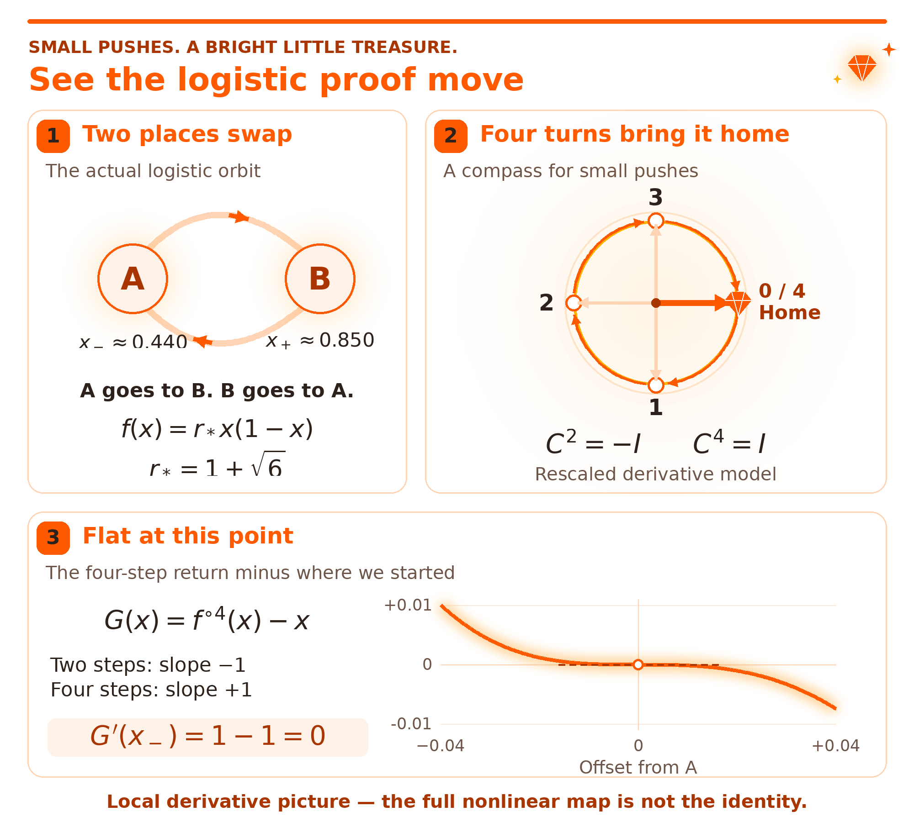

# The logistic quarter-turn

A focused reading note from the Pirate Chest

**Zolton / EncapsulatorP · with ChatGPT / 23 November 2026**

Source commit: `cc3f20117eaead570db6077377a43a92c0bfc652`

## The logistic quarter-turn

*NOTE 01 · EXACT LOCAL RESULT*

A two-cycle has return multiplier −1 at r = 1 + √6. Its paired derivative matrix has fourth power I, and the fourth-return displacement has zero first derivative at the cycle points.

$$
r_*=1+\sqrt{6},\qquad C_*^2=-I,\qquad C_*^4=I
$$

> **Exact local result (exact).** The result concerns the specified cycle points and the defined paired derivative model. The nonlinear fourth iterate is a degree-16 polynomial, not the identity map.

Start with the picture, then follow the second-iterate factorization and multiplier calculation. The two-point orbit and the four-turn linear model are explicitly separated.

### One concrete next step

Specify a geometric collapse model before connecting this local cancellation to a surface or brane. State its variables, map, topology and the exact sense in which a quantity vanishes.

### Sources and related reading

**[S1] Logistic quarter-turn.** EncapsulatorP, *Recovered constructions — independently checked proof notes*, §2. The factorization, paired matrix and fourth-iterate derivative statement are pinned to the reviewed source.

[[S1] Read the pinned logistic argument](https://github.com/EncapsulatorP/EncapsulatorP.github.io/blob/29f9232545aa112cd6ffa9fe1f3c0e85d093dedd/atlas/recovered-bridges.md#logistic-quarter-turn)

[Read the pinned collection source](https://github.com/EncapsulatorP/EncapsulatorP.github.io/blob/cc3f20117eaead570db6077377a43a92c0bfc652/atlas/logistic-vanishing-terms.md#logistic-proof-picture)

[Return to the Treasure Chest](https://encapsulatorp.github.io/#buried-logistic-vanishing)

## Follow the orange arrow

*01 · VISUAL TREASURE · FOLLOW THE THREE STEPS*

**Read it like a treasure map.** First, A and B swap places. Follow the orange arrow through four numbered moves. Then look for the flat dashed line at the centre of the curve.

In that linear model, the arrow returns exactly after four moves. For the nonlinear map, the conclusion is local: the derivative of f∘4 − id vanishes at the cycle points. The following pages give the complete algebra.

[Watch the picture move · animated PNG (APNG)](https://encapsulatorp.github.io/atlas/assets/logistic-proof.apng)

Click the picture or link to open the animation in a browser. The PDF itself displays the still illustration; the travelling arrows guide us between the discrete steps.

## The logistic two-cycle

*02 · EXACT ALGEBRA*

Let fr(x) = rx(1 − x). For r > 3 the following formulas give a nontrivial real two-cycle. The usual invariant-interval logistic setting additionally restricts r ≤ 4; the distinguished parameter used here lies in that range.

$$
f_r(x)=rx(1-x)
$$

Expanding the second iterate and factoring gives the exact polynomial identity

$$
f_r^{\circ 2}(x)-x=-x(rx-r+1)\,Q_r(x),
$$

$$
Q_r(x)=r^2x^2-r(r+1)x+r+1.
$$

The linear factors describe fixed points. The quadratic supplies the two distinct points

$$
x_\pm=\frac{r+1\pm\sqrt{(r-3)(r+1)}}{2r},
$$

$$
f_r(x_+)=x_-,\qquad f_r(x_-)=x_+.
$$

They merge with a fixed point at r = 3. Differentiate the original map at the two-cycle points and put d± = f′r(x±):

$$
d_\pm=-1\mp\sqrt{(r-3)(r+1)},
$$

$$
\mu(r):=d_+d_-=4+2r-r^2.
$$

The chain rule makes μ(r) the derivative of the second iterate at either point. Solving μ(r) = −1 in the positive logistic range gives

$$
r_*=1+\sqrt{6}\approx3.4494897427831780982.
$$

> **Meaning of the multiplier (exact).** The derivative of one complete two-step return is −1 at r*. After two such returns, the derivative is +1. The next page turns this calculation into the precise vanishing statement.

Source: the pinned recovered-bridges note [S1]. The polynomial factorization and critical multiplier were also checked by exact symbolic expansion.

## What vanishes, and where

*03 · LOCAL RESPONSE AND A QUARTER-TURN*

Define the paired derivative matrix by the chosen order of the two phases:

$$
C_r=\begin{pmatrix}0 & d_- \\ d_+ & 0\end{pmatrix},\qquad C_r^2=\mu(r)I.
$$

At r* = 1 + √6, the discriminant equals 2. Thus

$$
C_*=\begin{pmatrix}0 & \sqrt{2}-1 \\ -1-\sqrt{2} & 0\end{pmatrix},\qquad C_*^2=-I,\quad C_*^4=I.
$$

Writing a = √2 − 1 and S = diag(√a, 1/√a), direct multiplication gives

$$
S^{-1}C_*S=\begin{pmatrix}0 & 1 \\ -1 & 0\end{pmatrix}=:J.
$$

This is a clockwise quarter-turn after a linear change of coordinates. In the original Euclidean metric C* is not orthogonal: its squared column lengths are (1 + √2)² and (√2 − 1)².

$$
\left(f_{r_*}^{\circ 2}\right)'(x_\pm)=-1,\qquad \left(f_{r_*}^{\circ 4}\right)'(x_\pm)=1,
$$

$$
\boxed{\left(f_{r_*}^{\circ 4}-\mathrm{id}\right)'(x_\pm)=0.}
$$

The exponent per application of the original map along this periodic orbit is

$$
\lambda_{\mathrm{cycle}}=\frac12\log|d_+d_-|=\frac12\log 1=0.
$$

> **Three different statements (exact).** The displacement f∘4 − id has zero first derivative at the cycle points; the cycle Lyapunov exponent is zero; and the defined matrix has fourth power I. Each statement follows from the multiplier calculation.

The nonlinear fourth iterate has degree 16 for r ≠ 0, so it is not the identity map. Nor does zero cycle exponent itself prove nonlinear stability at the transition. The logistic critical point x = 1/2, where f′r(x) = 0, is another distinct use of the word “vanishing”.

The assertions above concern the two specified cycle points; they do not claim those are the only zeros of the derivative of f∘4 − id.
