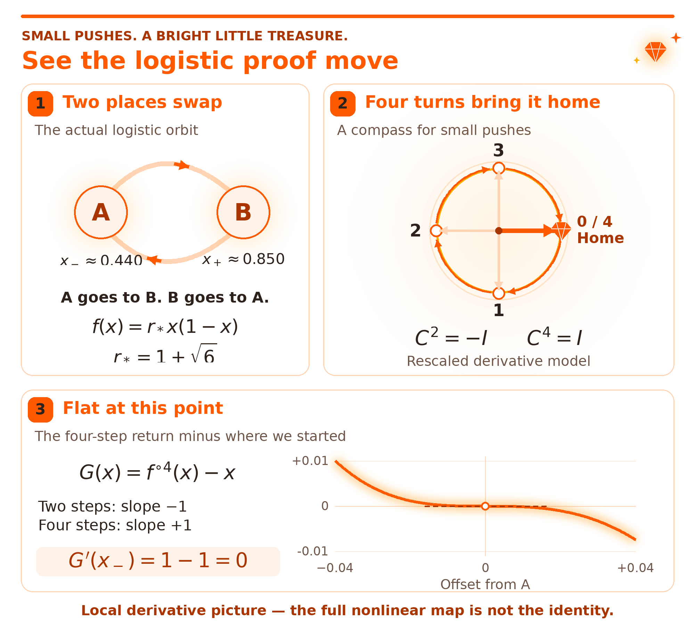
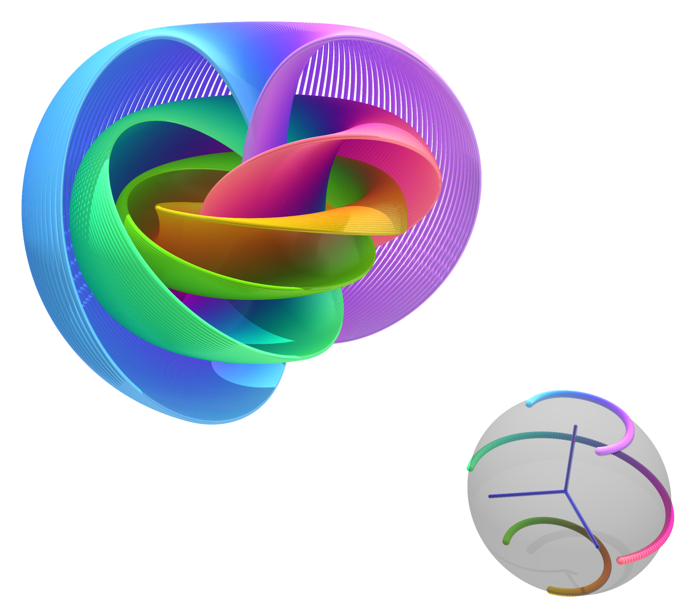
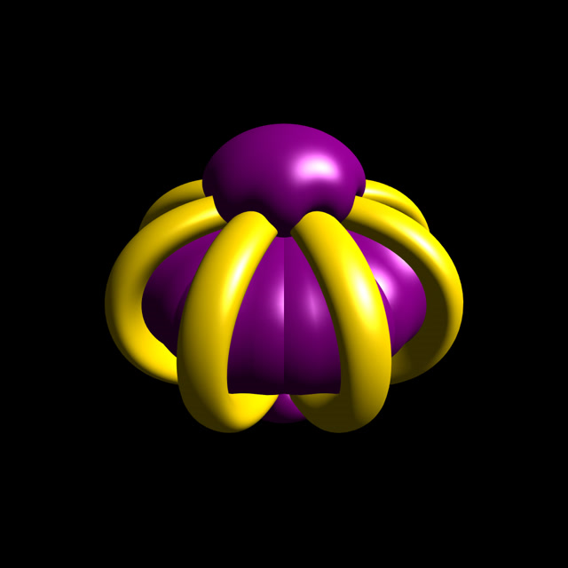

# Next treasures hunt

A visual guide to the EncapsulatorP Pirate Chest. Edition: 23 November 2026.

**Start:** [Treasure hunt](https://encapsulatorp.github.io/treasure-hunt/).
**Plan:** [Pirates Plan](https://encapsulatorp.github.io/#pirates-plan).
**Graph:** [Repository connections](https://encapsulatorp.github.io/#repo-interlinks).

## 1. Read the route

A small proof is a treasure. Follow the steps. Ask what survives.

- Exact: a result with explicit assumptions and a written argument.
- Conditional: the conclusion depends on a stated assumption.
- Exploratory: a proposed route with a concrete target still to test.

The guide is navigation; the individual notes contain the complete statements and proofs. The status labels make no claim of research novelty or formal proof-assistant certification.

## 2. Follow the logistic arrows

For f(x) = r*x*(1-x), at r = 1 + sqrt(6), the nontrivial two-cycle exchanges x-minus and x-plus. The paired derivative matrix satisfies C^2 = -I and C^4 = I. The compass picture uses rescaled coordinates for that linear model. The nonlinear fourth iterate is a degree-16 polynomial.

[Open the quarter-turn proof](https://encapsulatorp.github.io/atlas/proofs/logistic-quarter-turn.pdf).



## 3. Follow what vanishes

At either two-cycle point p, the fourth-return displacement has the local expansion

```text
f^4(p+h) - (p+h) = -K*h^3 + O(h^4), K > 0.
```

The constant, linear and quadratic displacement terms vanish; a restoring cubic remains. The derivative of f^4 itself equals 1 at p. The paired matrix C has determinant 1 and rank 2, so it preserves area and loses no direction.

The note also defines a small mathematical model: let g(h) = f^4(p-plus+h) - p-plus and apply Phi(theta,h) = (theta+omega modulo 2*pi, g(h)). The circle h=0 is invariant; a sufficiently small transverse distance tends to zero while angular motion survives. This is a local, asymptotic result.

**Vanishing-brane target:** define the intended object and connect it to the explicit toy by a stated map or invariant. A physical brane interpretation has not been supplied.

[Open the exact local lemma and scope](https://encapsulatorp.github.io/atlas/proofs/logistic-collapse-vanishing.pdf).

## 4. Choose one proof island

| Note | Scope |
|---|---|
| [Alternating towers](https://encapsulatorp.github.io/atlas/proofs/alternating-towers.pdf) | Proved convergence and classification for the defined alternating-sign system. |
| [Logistic quarter-turn](https://encapsulatorp.github.io/atlas/proofs/logistic-quarter-turn.pdf) | Exact local derivative result. |
| [Logistic collapse and vanishing terms](https://encapsulatorp.github.io/atlas/proofs/logistic-collapse-vanishing.pdf) | Exact local cubic lemma; geometric or physical model still open. |
| [Dyadic remainder](https://encapsulatorp.github.io/atlas/proofs/dyadic-remainder.pdf) | Proved bound along the specified path. |
| [Prime polynomials](https://encapsulatorp.github.io/atlas/proofs/prime-polynomial-counts.pdf) | Exact finite counting identities. |
| [Palindrome counting](https://encapsulatorp.github.io/atlas/proofs/palindrome-counting.pdf) | Exact count under a stated sampling model. |
| [Two constructions of six](https://encapsulatorp.github.io/atlas/proofs/fractional-exponential-maps.pdf) | Exact formulas; limiting orbit means require more work. |
| [Dimensions and fragments](https://encapsulatorp.github.io/atlas/proofs/dimensions-and-fragments.pdf) | Known foundations; incomplete fragments remain unresolved. |
| [The Z(p) family](https://encapsulatorp.github.io/atlas/proofs/schanuel-zeta-family.pdf) | Conditional on complex Schanuel. |
| [Proof review](https://encapsulatorp.github.io/atlas/proofs/proof-review.pdf) | Correctness, scope and novelty are separate questions. |

## 5. Explore neighboring geometry

### Hopf fibration

Each colored point on the small sphere corresponds to a circle fiber in the three-sphere. The large shape projects those fibers into a three-dimensional ball. This description follows [Niles Johnson's creator explanation](https://nilesjohnson.net/hopf.html).



Image: [Niles Johnson, Hopf Fibration](https://commons.wikimedia.org/wiki/File:Hopf_Fibration.png), [CC BY 4.0](https://creativecommons.org/licenses/by/4.0/). User-supplied resized copy, preserved without further changes.

### Sphere eversion

A sphere turns inside out through smooth immersed surfaces. Self-intersections are allowed; tears, creases and pinch points are not. See [the creator's explanation and full video](https://commons.wikimedia.org/wiki/File:Thurston_Sphere_Eversion.webm).



Frame: copyright 2022 Carsten Steger, [CC BY-SA 4.0](https://creativecommons.org/licenses/by-sa/4.0/). Extracted at 15 seconds and resized; the derivative keeps the same license.

**Proposed bridge target:** write down a map from a stated logistic object; define its domain and output; prove one preserved quantity or exhibit a counterexample. These illustrations establish no logistic or physical-brane equivalence.

## 6. Choose the next useful step

1. **Now: polish one small theorem.** Deliver one statement, a full proof, reproducible checks and focused questions for external review. Start with the [alternating-tower note](https://encapsulatorp.github.io/atlas/proofs/alternating-towers.pdf).
2. **Next: make the brane link precise.** Define the intended object and connect it to the explicit toy by a stated map or invariant. Follow the [Obstruction-Theory repository](https://github.com/EncapsulatorP/Obstruction-Theory).
3. **Then: recover one Collatz bridge.** Deliver one falsifiable claim linking the delay embedding to a specified diagnostic, with its scope recorded. Follow the [Collatz-Rupert repository](https://github.com/EncapsulatorP/collatz_rupert_delay_embedding).

Order by clarity and reuse. The [full Pirates Plan](https://encapsulatorp.github.io/#pirates-plan) carries the larger schedule, and the [repository graph](https://encapsulatorp.github.io/#repo-interlinks) records the connections.

## Rebuild and media records

Run `python3 atlas/build_treasure_hunt_guide.py`. The guide uses the existing DejaVu font families and mathematical text renderer. The logistic figure remains unchanged; precise equations and the determinant illustration are drawn from their definitions. Source media credits and hashes are in `atlas/assets/treasure-hunt/media-sources.json`.

This PDF contains static figures. The website supplies animation and interaction.
