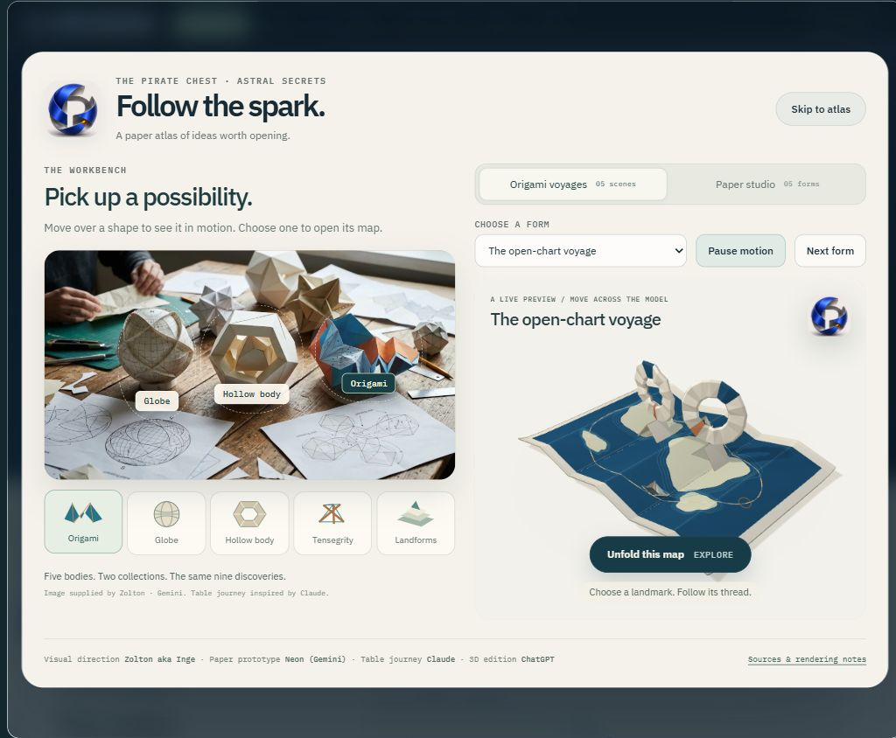
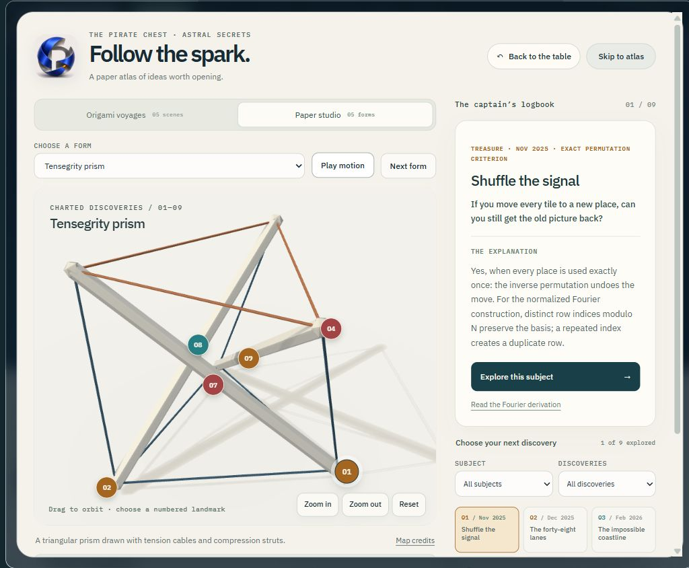

# Published atlas · visual record

Captured on 21 November 2026 from the deployed main page at code release [`4a954e809d634eb5708787c9e2f223a3ae6ddb05`](https://github.com/EncapsulatorP/EncapsulatorP.github.io/commit/4a954e809d634eb5708787c9e2f223a3ae6ddb05).

The page was rendered inside the 1024 × 844 responsive-check frame. Captures preserve the rendered page pixels; the surrounding test toolbar is outside the captured region.

## Shared workbench

The supplied reference image, live voyage preview, original logo, five body choices and both collections are visible.

## Larger standalone tensegrity

The structure, subject explanation, direct subject link and return-to-table control are visible. Motion was paused for this capture while verifying the Pause control; it was resumed afterwards. Default arrival motion remains enabled unless reduced motion is requested.

The code release passed both the Proof HTML workflow and GitHub Pages deployment. The [release checks](../../atlas/design-qa.md) distinguish rendered observations from static geometry and arithmetic checks.
