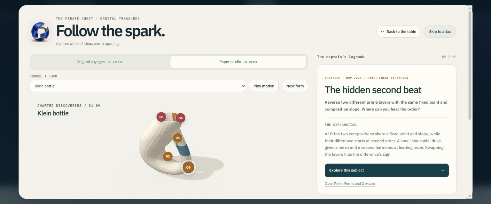
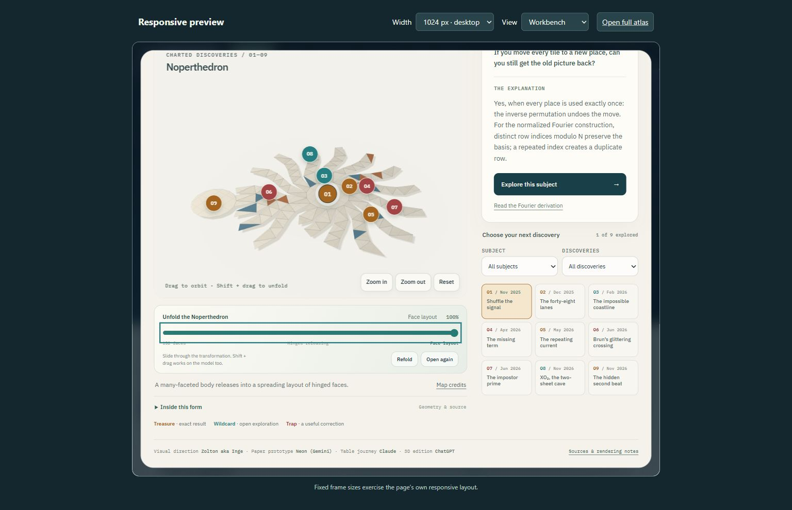
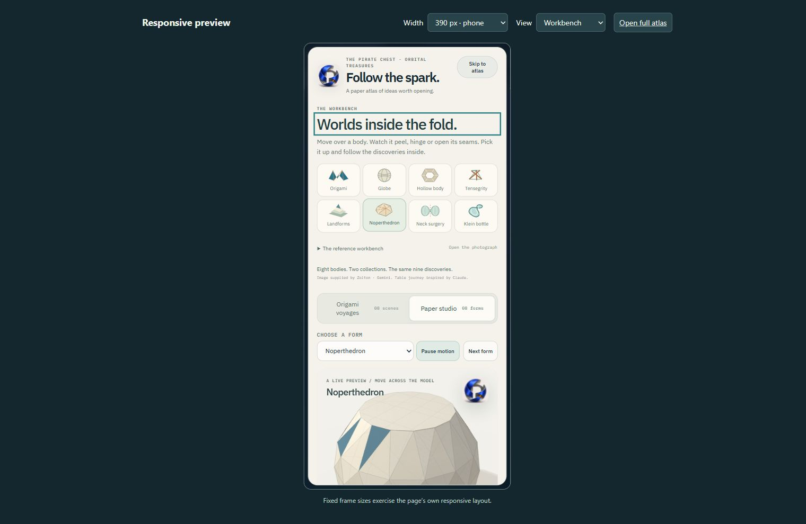

# Published atlas · visual record

## Body openings · published edition

Code release [`32c3c699104408b615afbe5b8d6d4021464af56d`](https://github.com/EncapsulatorP/EncapsulatorP.github.io/commit/32c3c699104408b615afbe5b8d6d4021464af56d)
passed Paper shapes, Proof HTML and GitHub Pages deployment on 21 November 2026.

The following JPEGs preserve the actual browser captures without image editing.

### Klein bottle, live main page

The bottle is held at the closed endpoint for inspection. The original logo,
eight-member collection switches, subject explanation and separate source link
remain visible. The abstract surface and its cut-open seam interpretation are
explained in the model's own source notes.

### Noperthedron, opening preview

This capture records the fully opened 152-face layout in the earlier isolated
preview at `88763add080bccf35df775968427ff2a3e3cb3a6`. The final release improved
the closed-body camera framing after this capture. This image documents the
opening geometry, not the final closed-body framing or a nonoverlap proof.

### Phone entrance, live main page

The final main page is rendered in a 390 × 844 frame. All eight body choices are
available above the live model. The reference photograph can be expanded. The
surrounding preview toolbar is retained so the frame size is explicit.

## Earlier workbench release

Captured on 21 November 2026 from the deployed main page at code release [`4a954e809d634eb5708787c9e2f223a3ae6ddb05`](https://github.com/EncapsulatorP/EncapsulatorP.github.io/commit/4a954e809d634eb5708787c9e2f223a3ae6ddb05).

The page was rendered inside the 1024 × 844 responsive-check frame. Captures preserve the rendered page pixels; the surrounding test toolbar is outside the captured region.

## Shared workbench

The supplied reference image, live voyage preview, original logo, five body choices and both collections are visible.

## Larger standalone tensegrity

The structure, subject explanation, direct subject link and return-to-table control are visible. Motion was paused for this capture while verifying the Pause control; it was resumed afterwards. Default arrival motion remains enabled unless reduced motion is requested.

The code release passed both the Proof HTML workflow and GitHub Pages deployment. The [release checks](../../atlas/design-qa.md) distinguish rendered observations from static geometry and arithmetic checks.
