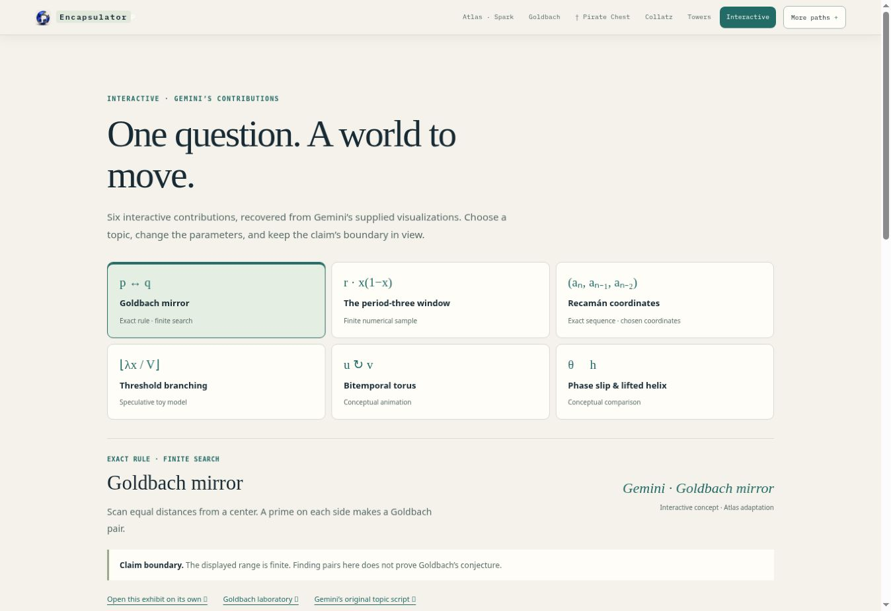

# Gemini Interactive and map-minimum review

Reviewed 21 November 2026. This records the initial six-view edition. The [subsequent restoration review](gemini-restoration-review-20261121.md) covers the ten-view collection, recovered sources, live WebGL inspection and phone framing fixes.

## Published result

Six signed Gemini topics are available under `#interactive`, with Interactive immediately before More paths. The six primary navigation destinations share the paper/teal theme. All sixteen map forms have at least one Treasure, Trap and Wildcard through `mapMinimumPicks`, separate from the strongest supported shape connection.

## Verified

- Static integration: 257 local targets, 287 unique IDs, and 23 JavaScript syntax checks across the requested pages passed.
- The map catalog verifies all sixteen forms, the eight body pairs, all twelve openings and the nine preserved research stops. The new minimum-kind invariant passes for every body.
- Evidence-order harness: 25/25 behavioral checks passed; previews remain excluded.
- Independent finite checks cover all 91 Goldbach centers / 568 pairs, 7,500 Recaman transitions and three coordinate modes, logistic sampling, threshold escape, and paused-helix history.
- Live Goldbach Next radius changes the displayed radius from 0 to 1. The logistic Period-three sample changes r to 3.8300. The threshold boundary inputs produce last value 202.0 and report leaving x <= 100 at n=4.
- Live map: the Klein voyage retains all three guaranteed discovery buttons under a Trap-only filter. Choosing its Treasure clears the filter, selects the correct stop and keeps the same map form.
- A 320px Interactive frame had client width = scroll width = 303px. Earlier Recaman and evidence-index phone checks also had no horizontal overflow.
- Live review found and repaired an inherited tab-panel style. The final desktop panel and topic grid both measure 1020px, with no inherited blue left border. The screenshot below records that final layout.
- The responsive review now includes a build query to avoid reusing the earlier cached HTML bundle. Hash navigation away from the map closes its modal.

## Limits

The fallback browser lacked WebGL; its explicit 3D-unavailable paths were observed. This is not a claim that all six exhibits received a complete GPU visual inspection in that browser. Mathematical finite checks are not Lean proofs.

The explicit A and B analytics probes queued on the production QA page. Receipt in the dedicated destination remains unverified, and collector verification is parked. No audience result or winning variant is claimed. See `atlas/evidence-experiment.md`.

