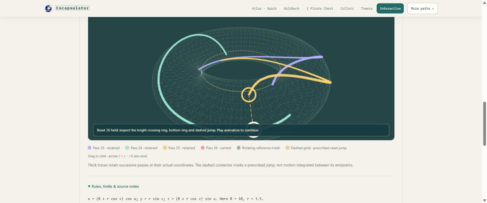
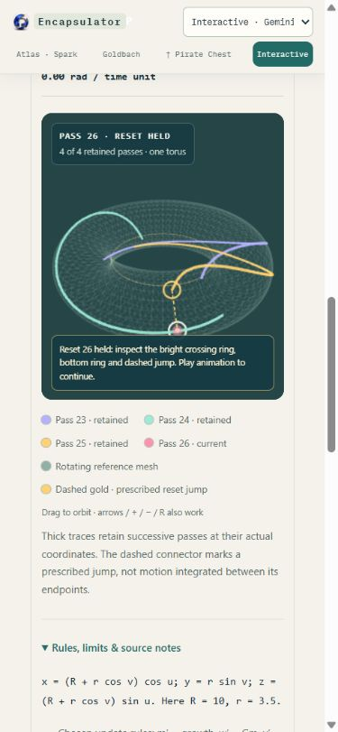
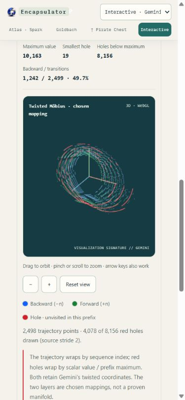
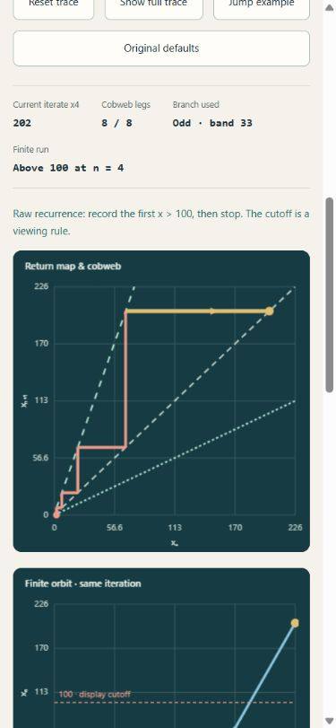
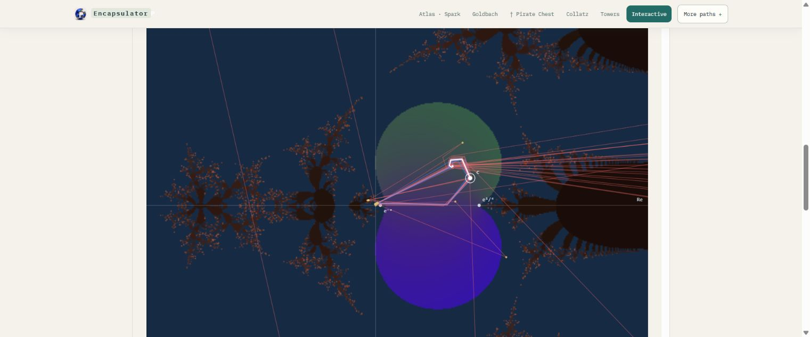

# Gemini restoration review · 21 November 2026

## Release and source recovery

The four requested exhibits are published in the Interactive room, with the strengthened torus beside them. The room has ten signed views backed by nine selected original widgets. Two of the views share the original threshold/Poincaré source.

- [Restoration commit](https://github.com/EncapsulatorP/EncapsulatorP.github.io/commit/4550d58bfbac58025de20df47b5844f88fa5c3fa): four exhibits, unchanged original scripts, torus overlay and reproducible verification.
- [Phone and contrast commit](https://github.com/EncapsulatorP/EncapsulatorP.github.io/commit/2edf78eda5f968a11499fa4370b0e37ffccfd379): responsive camera framing, stronger torus trails, compact phone topic chooser and accurate basin-color label.

Both code releases passed **Proof HTML**, **Paper shapes**, and **GitHub Pages build and deployment**. Live review followed deployment of the second release.

Original source filenames, full-file hashes and adaptation details are recorded in [sources.json](../interactive/sources.json). The full source-specific explanation is in [the contribution notes](../atlas/gemini-interactive-notes.md).

## Reproducible calculations

| Guard | Verified scope |
| --- | --- |
| atlas/verify_complex_tetration.cjs | 7,680 original field states/RGB samples; 72 seeded original ensemble orbits and 2,815 points; independent power, Gaussian-base-noise, noncumulative sheet, critical-base and zero/cutoff checks. |
| atlas/verify_recaman_obstructions.cjs | Exact prefix/gap fixtures at 200, 2,500 and 8,000 terms; 119,376 coordinate components against the original; 3,820,032 portrait projections, both mappings and camera/render paths. Relative zoom survives resize. |
| atlas/verify_goldbach_involution.cjs | All 71 accessible even totals match the original energies and plot endpoints; independent sieve, pair counting, midpoint multiplicity and full folded-orbit contributions. |
| atlas/verify_poincare.cjs | Raw 2→7→22→67→202 fixture; vertical/horizontal leg order; step/pause/reset/end/replay; 432 original capped parameter-grid cases and independent raw recurrence checks. |
| atlas/verify_torus_overlay.cjs | 12,000 mixed-step frames and 90 resets exactly match the supplied recurrence and displayed positions; both rendering adapters, four-pass bound, all view modes, catch/pause/reset, resource disposal and finite matrices. 3,072 surface projections fit a 330×360 stage; resize and R-reset preserve framing. |

These checks establish implementation fidelity over the stated cases. They are not proofs of open mathematical conjectures or physical interpretations.

## Live browser observations

### Complex tetration

The original complex seed displays “Tolerance met at n = 13.” With p = 0 and σ = 0, the upper real critical preset reports “No escape in 64,” 24/24 surviving paths and no mean escape step. It does not label that finite run divergent or globally bounded.

Clicking the embedded basin changes the seed and recomputes its paths. A right-arrow key then increases the real coordinate by 0.05. The basin visibly preserves the source’s tinted lobes, surrounding finite-iteration field, white principal orbit, red/blue ensemble paths and real-axis preset markers.

### Goldbach involution

Default N = 30 shows E+ = 8.00, E− = 2.00 and ρ = 0.2000. Moving N to 150 shows 29.50, 5.50 and 0.1571. The orbit inspection slider reaches the central fixed point k = 75. The phone layout keeps the live values and the two-row plot visible.

### Poincaré return map

“Jump example” followed by “Show full trace” shows x₄ = 202, 8/8 cobweb legs and first exit above 100 at n = 4. The coral vertical/horizontal path and gold current leg are visually distinct from the map and identity.

Changing to “Original capped replay” and showing the full trace gives x₅₀ = 100 and 100/100 legs. Returning to raw mode restores the uncapped finite fixture.

### Recamán holes and Möbius mode

The 2,500-term view reports maximum 10,163, smallest hole 19, 8,156 finite holes and 1,242/2,499 backward transitions. Toggling holes off leaves the full gap count intact; toggling back on reports 4,078 markers drawn with source stride 2.

Both the WebGL scene and the forced Canvas projection were inspected in the phone viewport. Twisted Möbius mode retains the red markers. The final responsive camera keeps the whole scene in frame. The main-site embedded WebGL view was also inspected after the framing fix.

### Torus superposition

The final phone view displays thick colored pass traces against a subdued reference mesh. It fits the full torus without the initial right-edge clipping.

Keyboard activation of “Catch next reset” held reset 26 with four retained passes, m = 0 and angular speed = 0. Switching to “Current pass,” then “Original view,” and back to “Superimposed passes” preserved that frozen state. The bright endpoint rings and dashed reset connector remained visible in overlay mode.

### Integration and responsive scope

- All ten topic options appear in the main room. Phones use the compact native selector; desktop retains the signed topic cards.
- Switching the compact selector from Recamán to Torus changes the embedded title and leaves exactly one selected iframe.
- The existing Interactive placement immediately before More paths remains.
- The desktop viewport was 1536×639 CSS pixels, with content width and scroll width both 1521 pixels. The active panel and frame host measured 1020 pixels during review.
- Phone checks used a 390×844 responsive browser viewport. Measured standalone content/scroll widths were equal at 375 pixels, with the browser scrollbar accounting for the remainder.
- No console errors were observed in the final main-site review.
- The temporary viewport override was reset. The live deliverable tab was left on the frozen torus overlay.

Responsive browser review is not a physical-handset certification. The torus Canvas path was exercised by the renderer harness; the live torus pixel review used WebGL. Recamán’s Canvas and WebGL paths both received live pixel review.

## Screenshots

These are unmodified browser screenshots. The torus and Recamán captures reflect the final framing/contrast release. The earlier Poincaré and complex-basin captures show unchanged mathematical views.

### Torus · desktop

### Torus · phone

### Recamán · phone WebGL

### Poincaré · phone

### Complex tetration · embedded desktop

