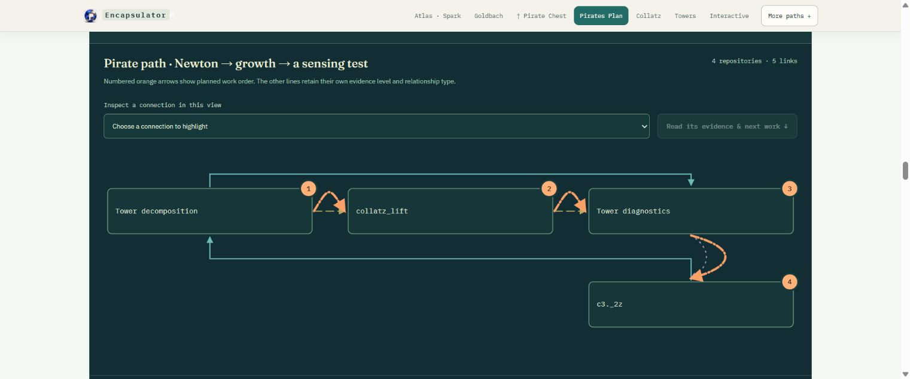

# Pirate paths and evidence map — publication verification

Verified on the public EncapsulatorP website on 21 November 2026.

## Published scope

- 32 current organization repositories: 20 public and 12 private.
- 55 recorded research/navigation connections: 16 known/documented bases, 31 proposed connections and 8 speculative bridges.
- Eight research routes, two numbered Pirate paths, six external bridges and ten Decision Targets.
- A known/documented label describes the stated source evidence. It does not certify a cross-repository equivalence. Orange expedition arrows express suggested work order.

## Checks observed in the live browser

- The whole graph reports **32 repositories · 55 links**, with evidence totals matching the canonical data.
- The speculative filter reports **8 links**. Their computed SVG style is purple (`rgb(207,176,244)`) with `2px, 7px` dots.
- Selecting E44 highlights the intended connection and displays its documented starting point and unresolved sensing question.
- A connection search that hides E44 returns zero results. Reading the selected connection clears that search and opens the correct evidence ledger entry.
- The first expedition displays **seven repositories, eight research links, seven stop cards and six orange work-order arrows**. Rupert is the first stop.
- The Newton-to-sensing expedition displays **four repositories, five research links and four stop cards**: two known, two proposed and one speculative connection.
- Known edges are cyan and solid; proposed edges are gold with `13px, 7px` long dashes; speculative edges are purple and dotted.
- Focusing Collatz lift from the sensing path preserves the path in the URL and keeps its itinerary. The return control restores the full expedition.
- At a 390 × 844 viewport override, the expedition selector and graph controls fit their containers; the graph scrolls inside its own region. Selecting either expedition updates the expected counts. The viewport override was reset.
- No browser console errors were observed during these interactions.

## Source and integration checks

The canonical generator validates inventory coverage, ranks, source pins, edge endpoints, evidence boundaries, route membership, path stops and stage dependencies. JavaScript syntax, URL round-trips, explicit evidence overrides, search indexing and path-layout bounds passed focused checks.

The final evidence router sends skipped same-row links above the row and diagonal links through empty row gaps. All five specially routed edges in the two current paths, including E13 and E15, avoid unrelated node boxes. The orange work-order routing is separate.

The native planning Page was updated in place; the preservation check confirmed every untouched prior block remained identical. The organization Decision Targets index was synchronized. Current source content outside the bounded planning room and its three asset versions was preserved.

Feature publication: [PR #13](https://github.com/EncapsulatorP/EncapsulatorP.github.io/pull/13). Routing correction: [PR #14](https://github.com/EncapsulatorP/EncapsulatorP.github.io/pull/14).

The site build, deployment and geometry/interaction checks passed for the feature publication. The separate existing Auto Assign workflow fails on PR events; it is unrelated to the site build and this graph feature.

Final routing publication: commit `4858911ec1ef68859f1fe6d702c1de8d94d6cf42`, planning assets `plan-20261121-r3`. Its build, deployment and geometry/interaction checks passed. Live DOM inspection confirmed E13 uses the empty row gap and E15 the upper lane; the final screenshot shows the correct endpoints without an intervening repository covering the lines. No console errors were observed. The public expedition tab was left open for review.

These checks cover the published interface and source consistency. They do not certify every mathematical result or run all experiments in the 32 repositories.
