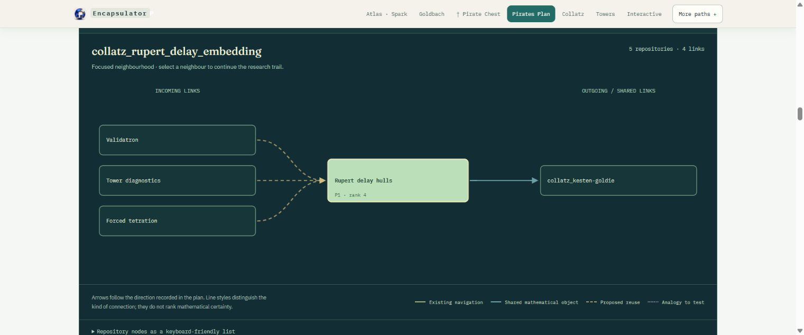

# Pirates Plan publication check

Verified on the public GitHub Pages deployment on 21 November 2026.

- The Pirates Plan route displays **Next treasures hunt planning** and all 32 organization repositories.
- The complete connection graph reports 32 repositories and 43 typed links.
- The Rupert direct link selects a neighborhood with five repositories and four connections.
- Searching `Norpert` returns `collatz_rupert_delay_embedding` and `Validatron` through the remembered alias and linked work.
- Searching `DNA` returns the connected physics/information route rather than requiring an exact repository name.
- Selecting private source displays 12 of 32 repositories.
- A nonexistent search returns zero results; clearing filters restores the register.
- At a 390 × 844 viewport override, repository controls and the graph chooser remain usable; the graph scrolls inside its own region. The temporary override was reset.
- The browser reported no console errors during these interactions.

The original publication commit passed the site's build, deployment and geometry/interaction workflow. The unrelated existing auto-assignment workflow failed on its PR event; this was not a site build or rendering failure.

These checks cover publication and the new navigation/search/graph behavior. They do not validate the mathematical claims or test suites of all 32 repositories.
